# Task 02: Agile Planning & DevOps Workflow

---

## Academic Project Metadata

- **Project Title:** Containerized Public Toilet Maintenance Tracker
- **Student Name:** Tamanna Shaikh
- **Roll Number:** 24102A2006
- **Department:** Computer Engineering
- **Institute:** Vidyalankar Institute of Technology
- **Course:** DevOps Laboratory
- **Academic Year:** 2026–2027
- **Project Directory:** `C:\Users\Sajiya\Desktop\Containerized_Public_Toilet_Maintenance_Tracker`
- **Current Task:** Task 02 – Agile Planning & DevOps Workflow
- **Document Version:** 1.0.0
- **Status:** Complete & Verified (Awaiting User Screenshot Evidence Capture)

---

## 1. Aim

To formulate a comprehensive Agile project management framework for the **Containerized Public Toilet Maintenance Tracker**, decompose the five MVP functional modules into structured Epics and User Stories with measurable acceptance criteria, establish a 15-task assignment Kanban workflow and 4-sprint delivery roadmap, define a rigorous Definition of Done (DoD), and model the complete 8-phase DevOps continuous lifecycle (Plan → Code → Build → Test → Release → Deploy → Operate → Monitor).

---

## 2. Scope & Objectives

1. **Epic Decomposition:** Formulate 5 primary MVP Epics directly reflecting the functional problem definition established in Task 01.
2. **User Story Formulation:** Detail user stories using the standard Agile template (`As a... I want... So that...`), assigning Story Points (Fibonacci scale) and MoSCoW priorities.
3. **Measurable Acceptance Criteria:** Establish verifiable, testable conditions using Gherkin syntax (`Given... When... Then...`) to guide both manual and automated Selenium test suite implementation.
4. **Prioritized Product Backlog:** Rank all backlog items to optimize velocity and address critical infrastructure dependencies early.
5. **Kanban Workflow Management:** Map all 15 academic tasks across *To Do*, *In Progress*, *Review*, and *Done* states, strictly preventing premature completion declarations.
6. **Sprint Planning:** Establish a realistic 4-sprint roadmap aligning team velocity with technical milestones and dependencies.
7. **Definition of Done (DoD):** Specify non-negotiable exit criteria across code quality, unit testing, containerization, CI pipeline execution, documentation, and visual evidence.
8. **DevOps Lifecycle Modeling:** Map the automated toolchain across all 8 phases of the continuous delivery feedback loop.

---

## 3. The Five MVP Epics

The system requirements formulated in Task 01 are decomposed into five core Epics:

```text
┌────────────────────────────────────────────────────────────────────────────────────────┐
│               Containerized Public Toilet Maintenance Tracker - MVP Epics               │
├─────────────────┬──────────────────┬──────────────────┬────────────────┬───────────────┤
│     EPIC-01     │     EPIC-02      │     EPIC-03      │    EPIC-04     │    EPIC-05    │
│   Maintenance   │    Searchable    │     Summary      │  Status Drill- │    Alert &    │
│  Data & Event   │    Facility &    │   Indicators &   │  Down & Ticket │   Exception   │
│      Entry      │ Ticket Dashboard │ Operational KPIs │   Lifecycle    │  Management   │
└─────────────────┴──────────────────┴──────────────────┴────────────────┴───────────────┘
```

### Epic 1: Maintenance Data & Event Entry (`EPIC-01`)
- **Objective:** Enable field sanitation workers and citizens to record cleaning rounds, report facility defects, and log maintenance requests with structured metadata (facility identifier, ward, issue category, urgency level, reporter timestamp).
- **Business Value:** Eliminates informal paper logs and ensures instantaneous digital ingestion of facility health data.

### Epic 2: Searchable Facility & Ticket Dashboard (`EPIC-02`)
- **Objective:** Provide a consolidated, responsive tabular interface displaying all monitored municipal toilet blocks, active complaints, and live maintenance tickets with multi-criteria real-time filtering.
- **Business Value:** Gives municipal ward officers an overview of public sanitation facilities and quick search capability across locations, wards, and severity.

### Epic 3: Summary Indicators & Operational KPIs (`EPIC-03`)
- **Objective:** Compute and visualize high-level operational metrics at the top of the administrative dashboard, including Total Facilities Monitored, Active Incidents, SLA Breaches (> 4 Hours), and Average Ward Cleanliness Rating.
- **Business Value:** Provides immediate situational awareness to municipal supervisors without manual data aggregation.

### Epic 4: Status Drill-Down & Ticket Lifecycle (`EPIC-04`)
- **Objective:** Deliver an inspection view/modal for individual facilities and incident tickets, displaying historical cleaning timestamps, assigned technicians, status transitions (`OPEN` → `IN_PROGRESS` → `RESOLVED`), and resolution notes.
- **Business Value:** Enforces accountability, tracks SLA elapsed times, and creates an audit trail of maintenance interventions.

### Epic 5: Alert & Exception Management (`EPIC-05`)
- **Objective:** Automatically flag and isolate critical operational hazards, such as water supply disruptions, non-functional lighting, sanitary hazards, or incidents remaining unresolved beyond the 4-hour SLA window.
- **Business Value:** Escalates emergency maintenance events to ensure rapid remedial action and prevent public health hazards.

---

## 4. User Stories Breakdown & Acceptance Criteria

Each user story is structured with technical identifiers, personas, MoSCoW priorities, story point estimates, and Gherkin-style acceptance criteria.

### Epic 1: Maintenance Data & Event Entry (`EPIC-01`)

#### User Story `US-01`: Log Facility Cleaning Event
- **Role:** As a **Field Sanitation Worker**,
- **Feature:** I want to submit a completed cleaning event record with facility ID, cleaning checklist items (floor, basins, disinfection), and consumable replenishment status,
- **Benefit:** So that my cleaning shift is digitally verified and the facility status updates immediately.
- **Priority:** Must Have | **Story Points:** 3 | **Sprint:** Sprint 2
- **Acceptance Criteria:**
  - **AC-01.1:** *Given* a valid facility ID, *When* the sanitation worker fills out the cleaning form and clicks "Submit Cleaning Log", *Then* the record is persisted to PostgreSQL and a `201 Created` HTTP response is returned within 200 ms.
  - **AC-01.2:** *Given* an incomplete form missing mandatory fields (e.g., cleaner ID or facility ID), *When* submission is attempted, *Then* the UI highlights invalid fields and blocks submission.

#### User Story `US-02`: Report Public Maintenance Defect
- **Role:** As a **Citizen Commuter / Ward Resident**,
- **Feature:** I want to report a maintenance failure (e.g., water shortage, flush breakdown, foul odor) by selecting a facility and category,
- **Benefit:** So that the municipal maintenance department is immediately notified of the breakdown.
- **Priority:** Must Have | **Story Points:** 5 | **Sprint:** Sprint 2
- **Acceptance Criteria:**
  - **AC-02.1:** *Given* a citizen on the portal, *When* they submit a complaint with severity `CRITICAL` (e.g., "No Water Supply"), *Then* a new incident ticket is generated with status `OPEN` and an emergency alert flag is triggered.
  - **AC-02.2:** *Given* a successful ticket generation, *When* the ticket is logged, *Then* a unique Tracking Reference ID (e.g., `TCK-2026-0042`) is displayed to the user.

---

### Epic 2: Searchable Facility & Ticket Dashboard (`EPIC-02`)

#### User Story `US-03`: Real-Time Facility & Ticket Table
- **Role:** As a **Ward Sanitation Officer**,
- **Feature:** I want to view a central tabular list of all public toilet facilities and tickets with sortable columns (Ward, Name, Cleanliness Score, Open Tickets, Last Cleaned),
- **Benefit:** So that I can monitor the operational state across my administrative jurisdiction.
- **Priority:** Must Have | **Story Points:** 5 | **Sprint:** Sprint 2
- **Acceptance Criteria:**
  - **AC-03.1:** *Given* the dashboard is loaded, *When* the page renders, *Then* all registered facilities in the database are displayed within 1.5 seconds.
  - **AC-03.2:** *Given* the table view, *When* the user clicks column headers (e.g., "Last Cleaned"), *Then* rows are sorted in ascending or descending order.

#### User Story `US-04`: Multi-Parameter Search & Filter
- **Role:** As a **Ward Sanitation Officer**,
- **Feature:** I want to filter the dashboard by Ward, Status (`OPEN`, `IN_PROGRESS`, `RESOLVED`), and Severity (`LOW`, `MEDIUM`, `HIGH`, `CRITICAL`),
- **Benefit:** So that I can isolate facilities needing immediate oversight.
- **Priority:** Must Have | **Story Points:** 3 | **Sprint:** Sprint 2
- **Acceptance Criteria:**
  - **AC-04.1:** *Given* 50 records in the table, *When* the user filters by Ward "Ward-F/North" and Status "OPEN", *Then* only matching facilities and tickets are shown instantly without a full page reload.
  - **AC-04.2:** *Given* a keyword typed in the search box, *When* the input matches a facility name, *Then* matching rows update dynamically with debounce latency $< 150\text{ ms}$.

---

### Epic 3: Summary Indicators & Operational KPIs (`EPIC-03`)

#### User Story `US-05`: KPI Metrics Display
- **Role:** As a **Municipal Administrator**,
- **Feature:** I want to inspect 4 summary KPI cards at the top of the dashboard showing Total Facilities, Active Tickets, SLA Breaches, and Average Hygiene Score,
- **Benefit:** So that I have executive-level visibility into city-wide sanitation performance.
- **Priority:** Must Have | **Story Points:** 3 | **Sprint:** Sprint 2
- **Acceptance Criteria:**
  - **AC-05.1:** *Given* backend data with 20 active complaints, *When* the dashboard loads, *Then* the "Active Tickets" card displays exactly `20`.
  - **AC-05.2:** *Given* any incident open for $> 4\text{ hours}$ without resolution, *When* calculated, *Then* the "SLA Breaches" card increments and highlights in red alert styling.

---

### Epic 4: Status Drill-Down & Ticket Lifecycle (`EPIC-04`)

#### User Story `US-06`: Facility & Incident Detail Modal
- **Role:** As a **Maintenance Supervisor**,
- **Feature:** I want to click any facility row to open a comprehensive detail modal showing cleaning logs, assigned crew, incident history, and geolocation,
- **Benefit:** So that I can investigate chronic sanitation issues before dispatching contractors.
- **Priority:** Should Have | **Story Points:** 5 | **Sprint:** Sprint 3
- **Acceptance Criteria:**
  - **AC-06.1:** *Given* a selected facility row, *When* clicked, *Then* a modal displays the complete maintenance history and current operational score.
  - **AC-06.2:** *Given* the detail view, *When* the supervisor closes the modal, *Then* background table state and active filters are fully preserved.

#### User Story `US-07`: Ticket Lifecycle Status Update
- **Role:** As a **Maintenance Technician**,
- **Feature:** I want to update a ticket's status from `OPEN` to `IN_PROGRESS` upon arrival, and to `RESOLVED` upon completing work with resolution notes,
- **Benefit:** So that ticket progress is tracked in real-time and resolution timestamps are archived.
- **Priority:** Must Have | **Story Points:** 3 | **Sprint:** Sprint 3
- **Acceptance Criteria:**
  - **AC-07.1:** *Given* an `OPEN` ticket, *When* updated to `RESOLVED` without resolution notes, *Then* validation fails and prompts for mandatory notes.
  - **AC-07.2:** *Given* a valid resolution submission, *Then* the ticket status updates in the database and the dashboard active count decrements immediately.

---

### Epic 5: Alert & Exception Management (`EPIC-05`)

#### User Story `US-08`: Critical Hazard Alert Banner
- **Role:** As a **Ward Sanitation Officer**,
- **Feature:** I want an alert view highlighting facilities with water outages or hygiene scores falling below 40%,
- **Benefit:** So that priority work orders can be dispatched immediately to prevent public inconvenience.
- **Priority:** Should Have | **Story Points:** 3 | **Sprint:** Sprint 3
- **Acceptance Criteria:**
  - **AC-08.1:** *Given* a facility reporting zero water supply, *When* the condition triggers, *Then* an emergency notification banner displays with a 1-click work order dispatch button.
  - **AC-08.2:** *Given* the exception view, *When* filtered by "SLA Breached", *Then* all tickets open $> 4$ hours are sorted by elapsed time descending.

---

## 5. Prioritized Product Backlog

| Rank | Story ID | Epic | User Story Title | MoSCoW | Points | Target Sprint | Technical Dependencies | Risk Level |
|:---:|:---:|:---:|---|:---:|:---:|:---:|---|:---:|
| **1** | `US-01` | `EPIC-01` | Log Facility Cleaning Event | **Must** | 3 | Sprint 2 | Database Schema, JPA Entities | Low |
| **2** | `US-02` | `EPIC-01` | Report Public Maintenance Defect | **Must** | 5 | Sprint 2 | `US-01`, REST API Endpoints | Low |
| **3** | `US-03` | `EPIC-02` | Real-Time Facility & Ticket Table | **Must** | 5 | Sprint 2 | JPA Repositories, Frontend Scaffolding | Medium |
| **4** | `US-04` | `EPIC-02` | Multi-Parameter Search & Filter | **Must** | 3 | Sprint 2 | `US-03`, Query Parameter Handler | Low |
| **5** | `US-05` | `EPIC-03` | KPI Summary Metric Cards | **Must** | 3 | Sprint 2 | `US-03`, Aggregation Service | Low |
| **6** | `US-07` | `EPIC-04` | Ticket Lifecycle Transition (`RESOLVED`) | **Must** | 3 | Sprint 3 | `US-02`, Validation Logic | Low |
| **7** | `US-06` | `EPIC-04` | Facility & Incident Drill-Down Modal | **Should**| 5 | Sprint 3 | `US-03`, Modal UI Component | Medium |
| **8** | `US-08` | `EPIC-05` | Critical Hazard & SLA Exception View | **Should**| 3 | Sprint 3 | `US-05`, Alerting Rules | Low |
| **9** | `US-09` | `EPIC-01` | Consumable Replenishment Logging | **Could** | 2 | Sprint 3 | `US-01`, Supply Stock Schema | Low |
| **10**| `US-10` | `EPIC-02` | CSV Export of Maintenance Logs | **Could** | 2 | Sprint 4 | `US-03`, File Export Stream | Low |

---

## 6. Kanban Workflow Plan (All 15 Assignment Tasks)

The 15 college DevOps tasks are tracked on a 4-state Kanban board. To uphold academic integrity and prevent unverified claims, **only tasks with verified implementation and approved deliverables transition across columns.**

```text
┌────────────────────────────────────────────────────────────────────────────────────────┐
│             Kanban Board: Containerized Public Toilet Maintenance Tracker              │
├───────────────────┬───────────────────┬───────────────────┬────────────────────────────┤
│    TO DO (13)     │  IN PROGRESS (1)  │    REVIEW (1)     │          DONE (0)          │
├───────────────────┼───────────────────┼───────────────────┼────────────────────────────┤
│ Task 03: Arch     │ Task 02: Agile    │ Task 01: Problem  │ *(No tasks marked Done     │
│ Task 04: Git      │   Planning &      │   Definition &    │   until all DoD gates &    │
│ Task 05: Features │   DevOps Workflow │   Scope Baseline  │   screenshots verified)*   │
│ Task 06: MVP      │                   │   (Pending image  │                            │
│ Task 07: Jenkins  │                   │    captures)      │                            │
│ Task 08: Pipeline │                   │                   │                            │
│ Task 09: Selenium │                   │                   │                            │
│ Task 10: ContTest │                   │                   │                            │
│ Task 11: Docker   │                   │                   │                            │
│ Task 12: Compose  │                   │                   │                            │
│ Task 13: Config   │                   │                   │                            │
│ Task 14: Reliab   │                   │                   │                            │
│ Task 15: Release  │                   │                   │                            │
└───────────────────┴───────────────────┴───────────────────┴────────────────────────────┘
```

### Complete 15-Task Kanban Classification Table

| Task ID | Task Title & Scope | Assigned Column | Entry Criteria Satisfied | Blocking / Exit Criteria to Advance |
|---|---|:---:|---|---|
| **Task 01** | Problem Definition & Scope Specification | **Review** | Comprehensive 24KB report authored, scope & 5 MVP modules established. | Awaiting visual screenshots (`task01_env_audit.png`, `task01_report_preview.png`). |
| **Task 02** | Agile Planning & DevOps Workflow | **In Progress** | Task 01 baseline approved; 5 Epics, User Stories, Sprint Plan, DoD, & Lifecycle SVG drafted. | Complete review, author `Task-02-Agile-Planning.md`, capture Kanban evidence. |
| **Task 03** | Architecture & Technology Stack Setup | **To Do** | Task 02 DoD approved. | Define modular architecture, ER schema, and port mapping specifications. |
| **Task 04** | Version Control & Git / GitHub Strategy | **To Do** | Task 03 architecture established. | Formalize GitFlow branching (`main`, `develop`, `feature/*`), protection rules. |
| **Task 05** | Core Feature Development | **To Do** | Git workflow active. | Implement Entity models, Repositories, Services, and REST Controllers. |
| **Task 06** | MVP Completion & Functional Validation | **To Do** | Core backend features built. | Integrate web dashboard UI with backend; end-to-end local validation. |
| **Task 07** | Jenkins CI Server & Build Pipeline Setup | **To Do** | Application buildable locally. | Configure Jenkins job, tools (JDK 17, Maven 3.9), and automated build trigger. |
| **Task 08** | Pipeline Automated Deployment | **To Do** | Basic CI build green. | Parameterize Jenkins pipeline, archive JAR artifacts, automate staging run. |
| **Task 09** | Selenium Automated UI Testing | **To Do** | Web UI functional. | Author Selenium WebDriver test suite for ticket creation and filter workflows. |
| **Task 10** | Continuous Testing & Quality Gates | **To Do** | Selenium tests functional. | Integrate headless Selenium tests into Jenkinsfile; capture Surefire XML reports. |
| **Task 11** | Containerization & Docker Lifecycle | **To Do** | Application test suite green. | Author multi-stage Dockerfile with unprivileged user, optimize image layers. |
| **Task 12** | Docker Compose & Continuous Delivery | **To Do** | Docker image validated. | Orchestrate multi-container stack (App + PostgreSQL) with healthchecks. |
| **Task 13** | Configuration Management & Drift | **To Do** | Docker Compose operational. | Manage environment variables, profiles, and configuration consistency. |
| **Task 14** | Infrastructure Provisioning & Reliability | **To Do** | Staging deployment stable. | Implement restart policies, log rotation, database backup/restore procedures. |
| **Task 15** | Final Release, Audit & Retrospective | **To Do** | Tasks 01–14 complete. | End-to-end system demo, consolidated documentation, viva presentation defense. |

---

## 7. Realistic Sprint Plan

The project execution is organized into four sequential 2-week equivalent Sprints.

```text
┌────────────────────────────────────────────────────────────────────────────────────────┐
│                              4-Sprint Execution Roadmap                                │
├───────────────────┬───────────────────┬───────────────────┬────────────────────────────┤
│     SPRINT 1      │     SPRINT 2      │     SPRINT 3      │          SPRINT 4          │
│   Inception &     │   Core Feature    │ Continuous Testing│     Containerization,      │
│  Setup (Tasks 1-4)│ Development (5-6) │  & CI (Tasks 7-10)│    CD & Hardening (11-15)  │
├───────────────────┼───────────────────┼───────────────────┼────────────────────────────┤
│ • Problem Scope   │ • Facility Entity │ • Jenkins CI Job  │ • Multi-Stage Dockerfile   │
│ • Agile Planning  │ • Ticket API      │ • Surefire Reports│ • Docker Compose Stack     │
│ • Modular Arch    │ • Web Dashboard   │ • Selenium Tests  │ • Port 8081 Remapping      │
│ • Git Strategy    │ • Filter / Search │ • Quality Gates   │ • Final Viva Demonstration │
└───────────────────┴───────────────────┴───────────────────┴────────────────────────────┘
```

### Sprint 1: Inception, Architecture & Repository Governance (Tasks 01 – 04)
- **Sprint Goal:** Establish problem baseline, Agile user stories, modular Spring Boot architecture, database ER schema, and Git version control strategy.
- **Tasks Included:** Task 01, Task 02, Task 03, Task 04.
- **Dependencies:** Environment tools installed (Java 17, Maven 3.9, Git 2.52+).
- **Key Deliverables:** Comprehensive Task 01 & Task 02 reports, high-level architecture diagram, GitFlow branching convention, and clean repository state.
- **Velocity Budget:** 13 Story Points equivalent.

### Sprint 2: Core Feature Development & MVP Completion (Tasks 05 – 06)
- **Sprint Goal:** Implement the 5 MVP feature modules (Data Entry, Dashboard Table, Summary KPIs, Drill-Down, and Alerts) with PostgreSQL integration.
- **Tasks Included:** Task 05, Task 06 (`US-01`, `US-02`, `US-03`, `US-04`, `US-05`).
- **Dependencies:** Sprint 1 architecture baseline and database schema design.
- **Key Deliverables:** Spring Boot Entities (`Facility`, `IncidentTicket`, `CleaningLog`), REST controllers, database migrations, responsive dashboard UI, and functional test suite.
- **Velocity Budget:** 19 Story Points.

### Sprint 3: Continuous Integration & Automated Selenium Testing (Tasks 07 – 10)
- **Sprint Goal:** Automate build verification through Jenkins CI, implement Selenium UI automated testing, and establish automated quality gates.
- **Tasks Included:** Task 07, Task 08, Task 09, Task 10 (`US-06`, `US-07`, `US-08`).
- **Dependencies:** Working web interface and Maven buildable artifact from Sprint 2.
- **Key Deliverables:** Jenkins Declarative Pipeline script ([`Jenkinsfile`](../Jenkinsfile)), automated build trigger upon commit, headless Selenium test suites, and JUnit Surefire XML reports.
- **Velocity Budget:** 16 Story Points.

### Sprint 4: Multi-Stage Containerization, CD, & Final Release (Tasks 11 – 15)
- **Sprint Goal:** Build production-grade multi-stage Docker container, orchestrate multi-container stack via Docker Compose, verify reliability, and complete final academic defense documentation.
- **Tasks Included:** Task 11, Task 12, Task 13, Task 14, Task 15 (`US-09`, `US-10`).
- **Dependencies:** Green CI build from Sprint 3 and Docker daemon runtime.
- **Key Deliverables:** Multi-stage [`Dockerfile`](../Dockerfile), multi-service [`docker-compose.yml`](../docker-compose.yml), automated deployment stage in Jenkins, database backup scripts, consolidated documentation package, and video/screenshot evidence catalog.
- **Velocity Budget:** 12 Story Points.

---

## 8. Definition of Done (DoD)

To ensure academic and engineering rigor, a task or user story is only declared **DONE** when all of the following criteria are satisfied:

```text
┌────────────────────────────────────────────────────────────────────────────────────────┐
│                           Definition of Done (DoD) Checklist                           │
├────────────────────────────────────────────────────────────────────────────────────────┤
│ [ ] 1. Implementation: Code complies with Java 17 / Spring Boot best practices.        │
│ [ ] 2. Static Quality: Zero compilation errors; zero compiler warnings; clean syntax.  │
│ [ ] 3. Unit Testing: 100% of JUnit 5 test cases pass via `mvn test`.                   │
│ [ ] 4. Automated UI Testing: Selenium WebDriver tests execute with zero failures.      │
│ [ ] 5. Security & Isolation: Docker containers execute under unprivileged user.       │
│ [ ] 6. Zero Host Conflict: Ports properly mapped (Host 8081 -> Container 8080).       │
│ [ ] 7. CI Pipeline Validation: Jenkins pipeline executes with STATUS: SUCCESS.        │
│ [ ] 8. Documentation: Task report authored with Aim, Scope, Code, and Conclusion.     │
│ [ ] 9. Visual Evidence: Actual PNG screenshots saved in `docs/screenshots/Task-XX/`.   │
│ [ ] 10. Peer Review & Git: Verified on feature branch and merged via Pull Request.     │
└────────────────────────────────────────────────────────────────────────────────────────┘
```

1. **Source Code & Implementation:** Code is written cleanly, formatted, modularized across Controller/Service/Repository layers, and implements the specified feature requirements.
2. **Compilation & Buildability:** Maven execution (`mvn clean compile` and `mvn package`) completes with `BUILD SUCCESS` and produces a valid executable JAR.
3. **Automated Unit & Integration Testing:** All JUnit 5 test cases execute without failure; surefire reports are recorded in `target/surefire-reports/`.
4. **Automated UI Testing:** Selenium WebDriver browser test suites successfully interact with form elements, buttons, and tables without unhandled exceptions or timing timeouts.
5. **Container Security & Best Practices:** Multi-stage Docker build achieves minimal image footprint; application runs under an unprivileged user (`appuser`); no secrets or credentials are hardcoded.
6. **Port Collision Prevention:** Port `8080` collision with host Jenkins is mitigated by explicit remapping to Host Port `8081` in [`docker-compose.yml`](../docker-compose.yml).
7. **Continuous Integration & Delivery:** Jenkins pipeline successfully executes all stages (`Checkout` → `Compile` → `Package` → `Selenium` → `Docker Build` → `Docker Deploy`) resulting in a green build.
8. **Academic Documentation:** Individual markdown report in [`REPORTS/`](./) is complete, thoroughly detailed, academically aligned, and adheres to college evaluation standards.
9. **Visual Proof & Evidence:** Real terminal execution output and browser UI captures are archived as PNG files in [`docs/screenshots/Task-XX/`](../docs/screenshots/) with descriptive annotations.
10. **Version Control:** Changes are isolated on appropriate feature branches and merged into `main` without merge conflicts.

---

## 9. DevOps Continuous Lifecycle Architecture

The project implements a closed-loop, automated DevOps lifecycle across eight distinct phases:

```mermaid
graph LR
    subgraph Plan_and_Develop ["Inception & Development"]
        Plan["1. PLAN<br/>Jira / Backlog<br/>User Stories"]
        Code["2. CODE<br/>Java 17 / Spring Boot<br/>GitFlow Branching"]
    end

    subgraph Build_and_Verify ["Continuous Integration"]
        Build["3. BUILD<br/>Maven 3.9<br/>JAR Packaging"]
        Test["4. TEST<br/>JUnit 5 Unit Tests<br/>Selenium UI Tests"]
    end

    subgraph Package_and_Deploy ["Continuous Delivery"]
        Release["5. RELEASE<br/>Multi-Stage Docker<br/>Non-Root Image"]
        Deploy["6. DEPLOY<br/>Docker Compose<br/>Jenkins Pipeline"]
    end

    subgraph Run_and_Observe ["Operations & Feedback"]
        Operate["7. OPERATE<br/>PostgreSQL 15<br/>Health Probes"]
        Monitor["8. MONITOR<br/>Docker Container Logs<br/>Health API Endpoint"]
    end

    Plan --> Code --> Build --> Test --> Release --> Deploy --> Operate --> Monitor
    Monitor -.->|"Continuous Feedback Loop"| Plan

    classDef plan fill:#dbeafe,stroke:#1d4ed8,stroke-width:2px;
    classDef build fill:#e0e7ff,stroke:#4338ca,stroke-width:2px;
    classDef deploy fill:#fef3c7,stroke:#d97706,stroke-width:2px;
    classDef operate fill:#ede9fe,stroke:#6d28d9,stroke-width:2px;

    class Plan,Code plan;
    class Build,Test build;
    class Release,Deploy deploy;
    class Operate,Monitor operate;
```



A dedicated high-resolution vector diagram has been generated and saved to:  
[`docs/diagrams/devops-lifecycle.svg`](../docs/diagrams/devops-lifecycle.svg)

### Detailed Phase-to-Tool Mapping

| Phase | Core Objective | Project Implementation & Tooling | Key Output / Artifact |
|---|---|---|---|
| **1. PLAN** | Backlog grooming, user story estimation, sprint commitment | Jira / GitHub Project Board / Markdown Backlogs | Sprint Backlog, User Stories with Acceptance Criteria |
| **2. CODE** | Feature development, entity design, REST API authoring | Java 17, Spring Boot 3.2.4, VS Code, Git | Clean source code in `src/main/java/` |
| **3. BUILD** | Dependency resolution, code compilation, artifact packaging | Apache Maven 3.9, Temurin JDK 17 | Executable `target/public-toilet-maintenance-tracker-1.0.0-SNAPSHOT.jar` |
| **4. TEST** | Unit validation, automated UI acceptance testing | JUnit 5, Mockito, Selenium WebDriver, Surefire | XML test reports in `target/surefire-reports/` |
| **5. RELEASE** | Multi-stage container packaging, non-root user enforcement | Docker Engine, Alpine Linux JRE 17 | Tagged Docker image `public-toilet-maintenance-tracker:v1.0` |
| **6. DEPLOY** | Multi-service stack orchestration and continuous rollout | Docker Compose, Jenkins CI/CD Pipeline | Application running on Host Port 8081, Postgres on 5432 |
| **7. OPERATE** | Reliable execution, data persistence, automatic restart | Docker Restart Policies (`always`), PostgreSQL volumes | Persistent container runtime on bridge network |
| **8. MONITOR**| Service health observation, log aggregation, defect feedback | Spring Boot Actuator, Health Endpoint (`/api/v1/health`), Docker Logs | Real-time health metrics, automated issue alerts |

---

## 10. Verification Procedure Executed for Task 02

The following engineering steps were executed to formulate and validate Task 02:

1. **Step 1 – Baseline Requirement Analysis:** Reviewed [`REPORTS/Task-01-Problem-Definition.md`](./Task-01-Problem-Definition.md) to extract the 5 core MVP modules, system constraints (Port 8080 Jenkins collision), and stakeholder expectations.
2. **Step 2 – Agile Epic & Story Authoring:** Formulated the five core Epics (`EPIC-01` to `EPIC-05`) and decomposed them into 10 prioritized user stories with explicit Gherkin acceptance criteria.
3. **Step 3 – Kanban Board Mapping:** Mapped the full 15-task college assignment across To Do, In Progress, Review, and Done columns, ensuring strict alignment with actual implementation states.
4. **Step 4 – Sprint Scheduling:** Created a balanced 4-sprint roadmap detailing goals, technical deliverables, and dependency gates.
5. **Step 5 – Definition of Done Formalization:** Authored a 10-point checklist governing task advancement.
6. **Step 6 – DevOps Lifecycle Modeling:** Designed and rendered the 8-phase DevOps feedback loop in both Mermaid format and vector SVG at [`docs/diagrams/devops-lifecycle.svg`](../docs/diagrams/devops-lifecycle.svg).
7. **Step 7 – Report Generation:** Compiled the comprehensive, academically compliant documentation into [`REPORTS/Task-02-Agile-Planning.md`](./Task-02-Agile-Planning.md).

---

## 11. Artifacts & Screenshot Instructions

### Required Visual Evidence

All visual artifacts for Task 02 must be saved in the directory:  
[`docs/screenshots/Task-02/`](../docs/screenshots/Task-02/)

| Screenshot Filename | Exact Screen / Window to Capture | Required Visual Elements | Purpose & Academic Verification |
|---|---|---|---|
| `task02_kanban_board.png` | GitHub Projects Board / Jira Board / VS Code Markdown Preview of the Kanban Plan | Visible columns: **To Do (13)**, **In Progress (Task 02)**, **Review (Task 01)**, and **Done (0)**. Clear card titles for Tasks 01–15. | Verifies active Agile project tracking and prevents unverified task completion claims. |
| `task02_devops_lifecycle.png` | Browser / Image Viewer displaying [`docs/diagrams/devops-lifecycle.svg`](../docs/diagrams/devops-lifecycle.svg) | Full 8-phase loop: Plan → Code → Build → Test → Release → Deploy → Operate → Monitor, with tool badges (Maven, Selenium, Docker, Jenkins). | Proves architectural understanding of the end-to-end continuous delivery pipeline. |
| `task02_report_preview.png` | Markdown Editor / Preview displaying [`REPORTS/Task-02-Agile-Planning.md`](./Task-02-Agile-Planning.md) | Visible Academic Metadata, Epics table, User Stories, and Sprint Plan. | Academic report authenticity proof for college submission. |

### How the Student Should Capture These Screenshots:
1. **For `task02_kanban_board.png`:** Open [`REPORTS/Task-02-Agile-Planning.md`](./Task-02-Agile-Planning.md) in VS Code Markdown Preview (or GitHub Project board if configured), scroll to Section 6 ("Kanban Workflow Plan"), and take a screenshot using `Windows + Shift + S`. Save as `docs/screenshots/Task-02/task02_kanban_board.png`.
2. **For `task02_devops_lifecycle.png`:** Open [`docs/diagrams/devops-lifecycle.svg`](../docs/diagrams/devops-lifecycle.svg) in Google Chrome or any SVG viewer at 100% zoom. Take a screenshot showing the diagram and save as `docs/screenshots/Task-02/task02_devops_lifecycle.png`.
3. **For `task02_report_preview.png`:** Open this report in your IDE preview showing the title and metadata, capture the top half, and save as `docs/screenshots/Task-02/task02_report_preview.png`.

---

## 12. Conclusion & Next Steps

Task 02 has successfully established a formal Agile management framework and DevOps architecture for the **Containerized Public Toilet Maintenance Tracker**:
- 5 MVP Epics defined with 10 user stories and measurable acceptance criteria.
- Complete 15-task Kanban board established with verified progress boundaries.
- 4-sprint roadmap structured with technical dependency gates.
- Strict 10-point Definition of Done formalized.
- 8-phase DevOps continuous lifecycle mapped and rendered in SVG.

### Next Action:
Upon review and screenshot capture for Task 02, proceed to **Task 03: Architecture & Technology Stack Setup**, which will formalize the Spring Boot 3 multi-tier package layout, PostgreSQL entity relationship schema, REST API contract specifications, and Docker/Jenkins port isolation strategy.
