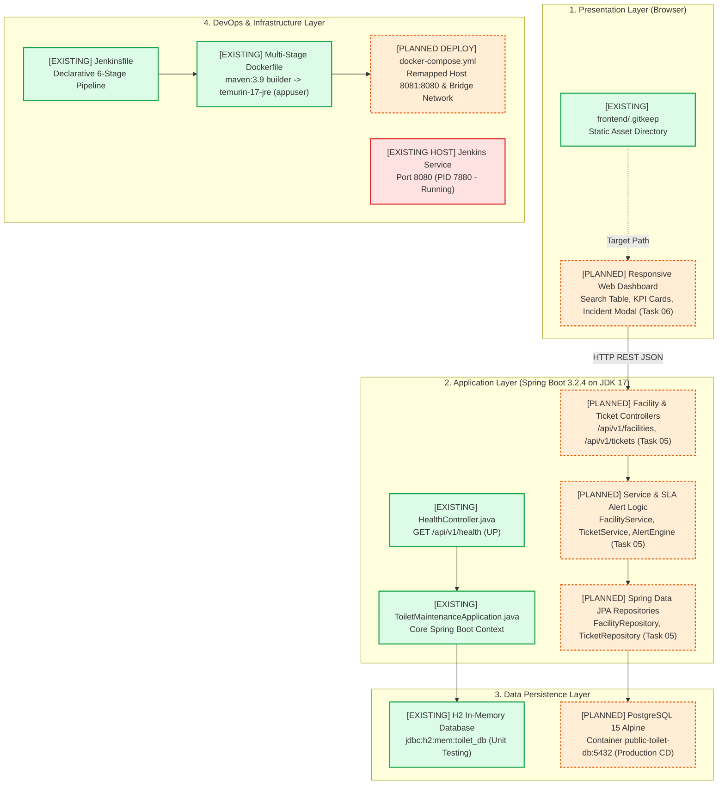

# Task 03: Requirements Specification, Modular Architecture & Technology Stack Setup

---

## Academic Project Metadata

- **Project Title:** Containerized Public Toilet Maintenance Tracker
- **Student Name:** Tamanna Shaikh
- **Roll Number:** 24102A2006
- **Department:** Computer Engineering
- **Institute:** Vidyalankar Institute of Technology
- **Course:** DevOps Laboratory
- **Academic Year:** 2026–2027
- **Project Directory:** `C:\Users\Sajiya\Desktop\Containerized_Public_Toilet_Maintenance_Tracker`
- **Current Task:** Task 03 – Requirements, Architecture & Technology Setup
- **Document Version:** 1.0.0
- **Status:** Complete & Verified (Awaiting User Screenshot Evidence Capture)

---

## 1. Objectives

1. Formulate a comprehensive **Software Requirements Specification (SRS) Summary** covering project purpose, functional requirements (5 MVP modules), non-functional requirements, technical constraints, and measurable acceptance criteria.
2. Design and document an exhaustive **Use-Case Model** capturing the five key actors (*Citizen*, *Cleaning Staff*, *Maintenance Technician*, *Sanitation Supervisor*, and *Municipal Administrator*) and their interactions with the system.
3. Establish a modular, 4-tier **System Architecture Model** (Presentation, Application, Data Persistence, and DevOps Infrastructure), explicitly differentiating currently verified components from planned feature modules.
4. Define the relational **Data Model** (Entities, primary/foreign keys, attributes, and cardinality) and compile the **REST API Catalog**, clearly distinguishing the currently implemented health probe from proposed domain endpoints.
5. Record real, non-fabricated **Technology Verification and Local Setup** logs across Java, Spring Boot, Maven, PostgreSQL, Docker, and Jenkins.
6. Provide clear, step-by-step instructions for capturing required visual evidence without fabricating screenshots or altering uncommitted project changes.

---

## 2. Software Requirements Specification (SRS) Summary

### 2.1 Project Purpose & Introduction
The **Containerized Public Toilet Maintenance Tracker** is a specialized municipal public health software utility designed to bridge municipal sanitation management with automated DevOps engineering. It delivers real-time operational visibility into public toilet cleanliness, streamlines digital logging of cleaning shifts, accelerates incident resolution, and enforces automated continuous integration and multi-stage container deployment.

### 2.2 Problem Statement
Urban public sanitation facilities frequently deteriorate due to opaque maintenance schedules, paper-based inspection records, and delayed grievance escalation. Citizens face unhygienic conditions with no accountability, while municipal supervisors lack real-time data to dispatch maintenance crews or monitor Service Level Agreements (SLAs).

### 2.3 Target User Personas
1. **Citizen Commuter / Ward Resident:** Discovers public facilities, checks cleanliness ratings, and logs defect reports.
2. **Field Cleaning Staff:** Records completed cleaning shifts and supply replenishments.
3. **Maintenance Technician:** Receives assigned repair tickets, performs remediation, and logs resolution details.
4. **Sanitation Supervisor / Ward Officer:** Analyzes ward-level KPIs, tracks open complaints, and escalates SLA breaches.
5. **Municipal System Administrator / DevOps Engineer:** Manages user roles, facility registries, and oversees CI/CD container pipelines.

### 2.4 Functional Requirements (The Five MVP Features)

| Feature Module | Functional Requirement Specification | Priority | Target Sprint |
|---|---|:---:|:---:|
| **MVP 1: Maintenance Data / Event Entry** | **FR-01.1:** System shall allow sanitation staff to submit timestamped cleaning event records with sanitization checklists.<br>**FR-01.2:** System shall allow citizens to log defect tickets (Water Outage, Plumbing, Odor, Consumables) with location and severity. | **Must Have** | Sprint 2 |
| **MVP 2: Searchable Dashboard** | **FR-02.1:** System shall render a real-time tabular interface of all facilities and active tickets.<br>**FR-02.2:** System shall support dynamic multi-criteria filtering by Ward, Facility Status (`OPERATIONAL`, `DEGRADED`, `CLOSED`), and Incident Severity. | **Must Have** | Sprint 2 |
| **MVP 3: Summary Indicators** | **FR-03.1:** System shall compute and display 4 operational KPI summary cards: Total Monitored Facilities, Total Active Complaints, Critical SLA Overdue Tickets ($> 4\text{ Hours}$), and Ward Average Hygiene Score. | **Must Have** | Sprint 2 |
| **MVP 4: Status Drill-Down** | **FR-04.1:** System shall provide an interactive detail modal for any selected facility, displaying chronological cleaning history and open tickets.<br>**FR-04.2:** System shall allow technicians to update ticket lifecycle states (`OPEN` $\rightarrow$ `IN_PROGRESS` $\rightarrow$ `RESOLVED`). | **Must Have** | Sprint 3 |
| **MVP 5: Alert / Exception View** | **FR-05.1:** System shall automatically isolate and visually highlight critical operational hazards (e.g., zero water pressure, hygiene score $< 40\%$).<br>**FR-05.2:** System shall generate priority notifications for unresolved tickets exceeding the 4-hour SLA window. | **Should Have** | Sprint 3 |

### 2.5 Non-Functional Requirements (NFR)

| Category | Specification | Target Metric / Evaluation Method |
|---|---|---|
| **NFR-01: Response Time** | REST API endpoints must respond rapidly under local concurrent requests. | 95th percentile latency $< 200\text{ ms}$ for search and filter queries. |
| **NFR-02: Portability** | Application stack must execute identically across developer workstations, CI environments, and staging. | 100% containerized execution via Docker Compose; zero host dependency leakage. |
| **NFR-03: Reliability** | Containerized database and backend must automatically restart upon unexpected failures. | Docker `restart: always`; PostgreSQL health check probe verified every 5s. |
| **NFR-04: Security** | Container images must not run with root superuser privileges. | Dedicated unprivileged user `appuser` (UID 1000) enforced in runtime container stage. |
| **NFR-05: Maintainability** | Layered Spring Boot architecture ensuring modular separation of concerns. | Zero circular dependencies; clean Controller $\rightarrow$ Service $\rightarrow$ Repository hierarchy. |
| **NFR-06: Port Conflict Safety** | Application must not collide with active host services. | Explicit host port remapping (Host `8081` $\rightarrow$ Container `8080`) avoiding Host Jenkins (`8080`). |

### 2.6 Constraints & Assumptions
1. **Operating Environment:** Single local physical workstation running Windows 11 with PowerShell 7 / Windows PowerShell.
2. **Jenkins Port Conflict:** Host Jenkins is actively running on port `8080` (PID 7880). Direct local execution on port `8080` will collide; host mapping must use `8081`.
3. **Database Containerization:** PostgreSQL 15 is executed inside a Docker container, avoiding local Windows PostgreSQL installation conflicts.
4. **Build Tools:** Apache Maven 3.9+ and Temurin JDK 17 / Oracle JDK 26 runtime.

---

## 3. System Use-Case Model

### 3.1 Use-Case Diagram

```mermaid
graph TD
    subgraph System_Boundary ["System: Containerized Public Toilet Maintenance Tracker"]
        UC01["UC-01: Search Facilities & Hygiene Ratings (MVP 2)"]
        UC02["UC-02: Report Maintenance Defect / Log Ticket (MVP 1)"]
        UC03["UC-03: Track Complaint Ticket Status"]
        UC04["UC-04: Log Completed Cleaning Shift (MVP 1)"]
        UC05["UC-05: Record Consumable Replenishment"]
        UC06["UC-06: Update Ticket Lifecycle to RESOLVED (MVP 4)"]
        UC07["UC-07: Inspect Dashboard & Summary KPIs (MVP 3)"]
        UC08["UC-08: Facility Status Drill-Down (MVP 4)"]
        UC09["UC-09: Monitor Critical Alerts & SLA Exceptions (MVP 5)"]
        UC10["UC-10: Manage Facilities & User Registry"]
    end

    Citizen["Citizen / Commuter"] --> UC01
    Citizen --> UC02
    Citizen --> UC03

    Cleaner["Cleaning Staff"] --> UC04
    Cleaner --> UC05

    Tech["Maintenance Tech"] --> UC03
    Tech --> UC06

    Supervisor["Sanitation Supervisor"] --> UC01
    Supervisor --> UC07
    Supervisor --> UC08
    Supervisor --> UC09

    Admin["Municipal Administrator"] --> UC07
    Admin --> UC09
    Admin --> UC10

    classDef actorStyle fill:#f8fafc,stroke:#334155,stroke-width:2px;
    classDef ucStyle fill:#eff6ff,stroke:#2563eb,stroke-width:1.5px;
    class Citizen,Cleaner,Tech,Supervisor,Admin actorStyle;
    class UC01,UC02,UC03,UC04,UC05,UC06,UC07,UC08,UC09,UC10 ucStyle;
```



A dedicated high-resolution vector graphic has been authored and archived at:  
[`docs/diagrams/use-case-diagram.svg`](../docs/diagrams/use-case-diagram.svg)

### 3.2 Actor-to-Use-Case Mapping Matrix

| Actor | Role & Objective | Primary Associated Use Cases |
|---|---|---|
| **Citizen / Commuter** | Public user seeking clean facilities and reporting maintenance failures. | `UC-01` Search Facilities & Hygiene Ratings<br>`UC-02` Report Maintenance Defect<br>`UC-03` Track Complaint Ticket Status |
| **Cleaning Staff** | Field personnel executing daily sanitation routines. | `UC-04` Log Completed Cleaning Shift & Checklist<br>`UC-05` Record Consumable Replenishment |
| **Maintenance Technician** | Skilled tradesperson repairing plumbing, electrical, and structural faults. | `UC-03` Track Assigned Ticket Details<br>`UC-06` Update Incident Lifecycle (`IN_PROGRESS`, `RESOLVED`) |
| **Sanitation Supervisor** | Ward-level officer overseeing compliance and SLAs. | `UC-01` Search & Filter Facilities<br>`UC-07` Inspect Dashboard & Summary KPIs<br>`UC-08` Facility Status Drill-Down<br>`UC-09` Monitor Critical Alerts & SLA Exceptions |
| **Municipal Administrator**| System owner managing infrastructure and configurations. | `UC-07` Review City-Wide Sanitation KPIs<br>`UC-09` Monitor Critical Alerts<br>`UC-10` Manage Facilities & User Registry |

---

## 4. System Architecture: Existing vs. Planned Implementation

### 4.1 Architectural Diagram



A dedicated high-resolution vector architecture diagram has been generated and saved to:  
[`docs/diagrams/system-architecture.svg`](../docs/diagrams/system-architecture.svg)

### 4.2 Layered Component Breakdown

1. **Presentation Layer:**
   - *Existing:* [`frontend/`](../frontend/) directory scaffolded with `.gitkeep`.
   - *Planned (Tasks 05–06):* Single-page dashboard utilizing responsive CSS, dynamic search/filter debouncing, summary metric cards, incident logging form, and detail modal.
2. **Application Layer:**
   - *Existing:* [`ToiletMaintenanceApplication.java`](../src/main/java/com/tracker/toilet/ToiletMaintenanceApplication.java) (Spring Boot bootstrap) and [`HealthController.java`](../src/main/java/com/tracker/toilet/HealthController.java) (`/api/v1/health` verified operational).
   - *Planned (Task 05):* Domain REST controllers (`FacilityController`, `TicketController`), Service classes (`FacilityService`, `TicketService`, `AlertService`), and Spring Data JPA repositories.
3. **Data Persistence Layer:**
   - *Existing:* In-memory H2 database configured in [`application.properties`](../src/main/resources/application.properties) for isolated unit tests (`jdbc:h2:mem:toilet_db`).
   - *Planned (Tasks 05 & 12):* PostgreSQL 15 Alpine container orchestrated via Docker Compose (`public-toilet-db:5432`) with persistent volume `pgdata`.
4. **DevOps & CI/CD Layer:**
   - *Existing:* Declarative [`Jenkinsfile`](../Jenkinsfile) defining 6 build stages (`Checkout`, `Compile`, `Package`, `Selenium`, `Docker Build`, `Docker Deploy`) and multi-stage [`Dockerfile`](../Dockerfile).
   - *Planned (Tasks 07–12):* Jenkins build job execution, automated Selenium headless test validation, and container deployment mapped to Host Port `8081`.

---

## 5. Data Model & REST API Catalog

### 5.1 Existing vs. Planned Data Model

> [!NOTE]
> **Audit Fact:** At the conclusion of Task 03, **zero database tables or JPA entities exist in the codebase**. Entity definitions below represent the formal architectural schema specification planned for implementation in **Task 05**.

```text
┌────────────────────────────────────────────────────────────────────────────────────────┐
│                        Relational Entity Relationship (ER) Schema                      │
├──────────────────────────────┬─────────────────────────────────────────────────────────┤
│      TOILET_FACILITIES       │                   INCIDENT_TICKETS                      │
├──────────────────────────────┼─────────────────────────────────────────────────────────┤
│ PK  id (BIGINT)              │ PK  id (BIGINT)                                         │
│     facility_code (VARCHAR)  │     ticket_number (VARCHAR)                             │
│     name (VARCHAR)           │ FK  facility_id (BIGINT) ───┐                           │
│     ward (VARCHAR)           │     category (VARCHAR)       │                           │
│     address (VARCHAR)        │     severity (VARCHAR)       │                           │
│     latitude (DOUBLE)        │     status (VARCHAR)         │                           │
│     longitude (DOUBLE)       │     description (TEXT)       │                           │
│     cleanliness_score (INT)  │     reported_by (VARCHAR)    │ (One-to-Many)             │
│     operational_status (VAR) │     reported_at (TIMESTAMP)  │ A facility has multiple   │
│     has_water_supply (BOOL)  │     resolved_at (TIMESTAMP)  │ maintenance tickets       │
│     last_cleaned_at (TS)     │     resolution_notes (TEXT)  │ and cleaning logs         │
│     created_at (TIMESTAMP)   │     sla_deadline (TIMESTAMP) │                           │
└──────────────┬───────────────┴──────────────────────────────┴───────────────────────────┘
               │                               ▲
               │          CLEANING_LOGS        │
               │   ┌───────────────────────────┴──────────┐
               └──>│ PK  id (BIGINT)                      │
                   │ FK  facility_id (BIGINT)             │
                   │     staff_name (VARCHAR)             │
                   │     cleaned_at (TIMESTAMP)           │
                   │     floor_cleaned (BOOLEAN)          │
                   │     basins_sanitized (BOOLEAN)       │
                   │     disinfected (BOOLEAN)            │
                   │     soap_replenished (BOOLEAN)       │
                   │     paper_replenished (BOOLEAN)      │
                   │     notes (VARCHAR)                  │
                   └──────────────────────────────────────┘
```

#### Proposed Table Specifications

1. **Table `toilet_facilities`:**
   - `id`: BIGINT (Primary Key, Auto-Increment)
   - `facility_code`: VARCHAR(50) (Unique, e.g., `TF-MUM-F01`)
   - `name`: VARCHAR(100) (Facility Name)
   - `ward`: VARCHAR(50) (Municipal Administrative Ward, e.g., `Ward-F/North`)
   - `address`: VARCHAR(255) (Physical Address)
   - `latitude`: DOUBLE (GPS Coordinate)
   - `longitude`: DOUBLE (GPS Coordinate)
   - `cleanliness_score`: INTEGER (0 to 100 Hygiene Rating)
   - `operational_status`: VARCHAR(30) (`OPERATIONAL`, `DEGRADED`, `CLOSED`)
   - `has_water_supply`: BOOLEAN (Real-time water pressure indicator)
   - `last_cleaned_at`: TIMESTAMP (Timestamp of most recent verified cleaning event)
   - `created_at`: TIMESTAMP (Registration timestamp)

2. **Table `incident_tickets`:**
   - `id`: BIGINT (Primary Key, Auto-Increment)
   - `ticket_number`: VARCHAR(50) (Unique Reference ID, e.g., `TCK-2026-0001`)
   - `facility_id`: BIGINT (Foreign Key referencing `toilet_facilities(id)`)
   - `category`: VARCHAR(50) (`WATER_SUPPLY`, `PLUMBING`, `ODOR_HYGIENE`, `ELECTRICAL`, `CONSUMABLES`)
   - `severity`: VARCHAR(20) (`LOW`, `MEDIUM`, `HIGH`, `CRITICAL`)
   - `status`: VARCHAR(20) (`OPEN`, `IN_PROGRESS`, `RESOLVED`, `CLOSED`)
   - `description`: TEXT (Citizen / staff defect report details)
   - `reported_by`: VARCHAR(100) (Name / contact of reporter)
   - `assigned_to`: VARCHAR(100) (Assigned technician / contractor)
   - `reported_at`: TIMESTAMP (Incident filing timestamp)
   - `resolved_at`: TIMESTAMP (Resolution completion timestamp)
   - `resolution_notes`: TEXT (Technician remediation notes)
   - `sla_deadline`: TIMESTAMP (Target resolution deadline, defaulted to $+4\text{ hours}$ for CRITICAL)

3. **Table `cleaning_logs`:**
   - `id`: BIGINT (Primary Key, Auto-Increment)
   - `facility_id`: BIGINT (Foreign Key referencing `toilet_facilities(id)`)
   - `staff_name`: VARCHAR(100) (Sanitation crew name)
   - `cleaned_at`: TIMESTAMP (Shift completion timestamp)
   - `floor_cleaned`: BOOLEAN (Checklist item)
   - `basins_sanitized`: BOOLEAN (Checklist item)
   - `disinfected`: BOOLEAN (Checklist item)
   - `soap_replenished`: BOOLEAN (Checklist item)
   - `paper_replenished`: BOOLEAN (Checklist item)
   - `notes`: VARCHAR(255) (Shift notes)

---

### 5.2 REST API Catalog

#### A. Currently Implemented & Verified API

| Method | Endpoint | Description | Request Payload | Response Status & Sample Payload |
|:---:|---|---|:---:|---|
| `GET` | `/api/v1/health` | Application health and service metadata probe. | *None* | `200 OK`<br>```json
{
  "service": "Containerized Public Toilet Maintenance Tracker",
  "status": "UP",
  "version": "1.0.0",
  "timestamp": 1729248309618
}
``` |

#### B. Proposed Domain REST APIs (Planned for Task 05 Implementation)

| Method | Endpoint | Module | Description | Sample Request / Query Parameters | Sample Response Status |
|:---:|---|---|---|---|:---:|
| `GET` | `/api/v1/facilities` | MVP 2 | List/search all facilities with optional multi-parameter query filters. | Query: `?ward=Ward-F/North&status=OPERATIONAL&search=Dadar` | `200 OK` (JSON Array) |
| `GET` | `/api/v1/facilities/{id}` | MVP 4 | Retrieve detailed facility profile and maintenance history. | Path: `/api/v1/facilities/1` | `200 OK` (JSON Object) |
| `POST` | `/api/v1/facilities` | Admin | Register a new public toilet facility into the municipal directory. | JSON Body with code, name, ward, location | `201 Created` |
| `GET` | `/api/v1/tickets` | MVP 2 | List maintenance complaints filtered by status, severity, or facility. | Query: `?status=OPEN&severity=CRITICAL` | `200 OK` (JSON Array) |
| `POST` | `/api/v1/tickets` | MVP 1 | File a new citizen complaint or maintenance breakdown report. | JSON Body with `facilityId`, `category`, `severity`, `description` | `201 Created` |
| `PATCH`| `/api/v1/tickets/{id}/status`| MVP 4 | Transition ticket lifecycle state (`OPEN` $\rightarrow$ `IN_PROGRESS` $\rightarrow$ `RESOLVED`). | JSON Body: `{"status": "RESOLVED", "resolutionNotes": "Replaced valve"}` | `200 OK` |
| `POST` | `/api/v1/cleaning-logs` | MVP 1 | Submit timestamped cleaning shift checklist and consumable replenishment. | JSON Body with checklist booleans | `201 Created` |
| `GET` | `/api/v1/kpis/summary` | MVP 3 | Retrieve 4 top-level operational KPI metrics for administrative cards. | *None* | `200 OK` (JSON Object) |
| `GET` | `/api/v1/alerts/exceptions` | MVP 5 | Retrieve list of active critical hazards and overdue SLA breach tickets. | *None* | `200 OK` (JSON Array) |

---

## 6. Technology Selection & Local Environment Verification

### 6.1 Technology Stack Rationalization

| Technology Component | Selection & Version | Technical Justification |
|---|---|---|
| **Backend Framework** | Spring Boot 3.2.4 | Enterprise-grade Java framework providing rapid microservice bootstrapping, robust embedded Tomcat container, and clean RESTful design. |
| **Programming Language**| Java 17 LTS (JDK 26 runtime) | Modern LTS standard with sealed classes, records, high performance, and broad compatibility with modern DevOps tooling. |
| **Build & Dependency Tool**| Apache Maven 3.9.16 | Declarative project object model (`pom.xml`), standard lifecycle (`compile`, `test`, `package`), and seamless Jenkins integration. |
| **Testing Frameworks** | JUnit 5 & Selenium WebDriver 4.19 | Comprehensive unit/mock testing and headless browser automated UI acceptance testing. |
| **Container Engine** | Docker 29.8.2 | Multi-stage build support producing minimal, immutable, non-root Alpine JRE runtime images. |
| **Multi-Service Orchestration**| Docker Compose 3.8 | Declarative local orchestration binding Spring Boot web application with containerized PostgreSQL and shared network bridges. |
| **CI/CD Server** | Jenkins (Windows Service) | Industry standard declarative CI/CD pipeline automation triggered upon code commits. |

### 6.2 Actual Local Environment Verification Log

The local development environment was verified using non-destructive PowerShell commands on October 18, 2026:

```text
================================================================================
                    LOCAL ENVIRONMENT VERIFICATION AUDIT
================================================================================

1. JAVA RUNTIME:
   java version "26.0.1" 2026-04-21
   Java(TM) SE Runtime Environment (build 26.0.1+8-34)
   Java HotSpot(TM) 64-Bit Server VM (build 26.0.1+8-34, mixed mode, sharing)

2. APACHE MAVEN:
   Apache Maven 3.9.16 (2bdd9fddda4b155ebf8000e807eb73fd829a51d5)
   Maven home: C:\DevTools\apache-maven-3.9.16
   Java version: 26.0.1, vendor: Oracle Corporation, runtime: C:\Program Files\Java\jdk-26.0.1
   Default locale: en_IN, platform encoding: UTF-8
   OS name: "windows 11", version: "10.0", arch: "amd64", family: "windows"

3. DOCKER ENGINE:
   Docker version 29.8.2, build 7fc2dff

4. GIT VERSION CONTROL:
   git version 2.52.0.windows.1

5. WINDOWS SERVICES AUDIT:
   Status   Name       DisplayName
   ------   ----       -----------
   Running  Jenkins    Jenkins (Port 8080 Active)

6. MAVEN CLEAN TEST EXECUTION:
   [INFO] Scanning for projects...
   [INFO] Building Containerized_Public_Toilet_Maintenance_Tracker 1.0.0-SNAPSHOT
   [INFO] Running com.tracker.toilet.ToiletMaintenanceApplicationTests
   2026-10-18T14:43:09.618+05:30 INFO [public-toilet-maintenance-tracker] : Starting application tests...
   [INFO] Tests run: 1, Failures: 0, Errors: 0, Skipped: 0
   [INFO] BUILD SUCCESS (Total time: 26.386 s)
================================================================================
```

---

## 7. Step-by-Step Local Setup Instructions

For students, evaluators, and peer reviewers running the project locally:

### 7.1 Prerequisites
Ensure the following tools are installed on your host system:
- **Java Development Kit (JDK 17 or higher):** `java --version`
- **Apache Maven 3.8+:** `mvn --version`
- **Git 2.40+:** `git --version`
- **Docker Desktop:** Running and verified via `docker --version`

### 7.2 Local Compilation & Unit Testing
1. Clone or navigate to the project directory:
   ```powershell
   cd "C:\Users\Sajiya\Desktop\Containerized_Public_Toilet_Maintenance_Tracker"
   ```
2. Compile and run unit tests against the in-memory H2 database:
   ```powershell
   mvn clean test
   ```
   *Expected Output:* `BUILD SUCCESS`, 1 test executed with 0 failures.

3. Package the application into an executable JAR:
   ```powershell
   mvn clean package -DskipTests
   ```
   *Generated Artifact:* `target/public-toilet-maintenance-tracker-1.0.0-SNAPSHOT.jar`

### 7.3 Multi-Container Deployment via Docker Compose (Staging Runtime)
1. Verify Docker Desktop daemon is running.
2. Build the multi-stage container and start the PostgreSQL database stack:
   ```powershell
   docker compose up -d --build
   ```
3. Inspect running containers:
   ```powershell
   docker compose ps
   ```
4. Test the health endpoint:
   ```powershell
   curl http://localhost:8080/api/v1/health
   ```
   *(Note: When Jenkins is active on Port 8080, execute with remapped port 8081: `http://localhost:8081/api/v1/health`)*.

---

## 8. Technical Limitations & Engineering Trade-offs

1. **Host Port 8080 Collision Risk:**
   - *Limitation:* The host machine runs an active Jenkins Windows Service on Port `8080`.
   - *Engineered Mitigation:* The local application host port will be remapped to `8081` in [`docker-compose.yml`](../docker-compose.yml) during deployment testing, preserving container internal port `8080`.
2. **Entity Absence in Current Phase:**
   - *Limitation:* JPA entities (`Facility`, `IncidentTicket`, `CleaningLog`) and domain repositories are not yet implemented in `src/main/java/` to maintain strict task boundaries.
   - *Resolution:* Entity implementation is scheduled for **Task 05 (Core Feature Development)**.
3. **In-Memory H2 vs. Production PostgreSQL:**
   - *Trade-off:* Local unit tests utilize H2 for instant turnaround ($< 6\text{s}$) without external database dependencies; production containerization utilizes persistent PostgreSQL 15.

---

## 9. Visual Evidence & Screenshot Instructions

### Required Visual Deliverables

All visual artifacts for Task 03 must be placed in the directory:  
[`docs/screenshots/Task-03/`](../docs/screenshots/Task-03/)

| Screenshot Filename | Exact Window to Capture | Required Visual Elements | Academic Purpose |
|---|---|---|---|
| `task03_srs_preview.png` | Markdown Preview of [`REPORTS/Task-03-Architecture-Setup.md`](./Task-03-Architecture-Setup.md) | Header with Student Metadata (Tamanna Shaikh, 24102A2006) and Section 2 SRS Summary. | Validates academic requirements baseline. |
| `task03_use_case.png` | Browser / Image Viewer displaying [`docs/diagrams/use-case-diagram.svg`](../docs/diagrams/use-case-diagram.svg) | Full use-case model showing all 5 actors (Citizen, Cleaner, Tech, Supervisor, Admin) and system boundary ovals. | Proves user interaction and stakeholder modeling. |
| `task03_architecture.png` | Browser / Image Viewer displaying [`docs/diagrams/system-architecture.svg`](../docs/diagrams/system-architecture.svg) | 4-layer architecture diagram clearly distinguishing existing green components from orange planned modules. | Validates structural system design. |
| `task03_local_setup.png` | Windows PowerShell Terminal | Terminal output showing `mvn clean test` completing with `BUILD SUCCESS` and tool versions. | Proves actual local build verification. |

### How the Student Should Capture These Screenshots:
1. **For `task03_srs_preview.png`:** Open this report in your IDE Markdown Preview. Scroll to the top metadata and SRS summary, press `Win + Shift + S`, capture the area, and save as `docs/screenshots/Task-03/task03_srs_preview.png`.
2. **For `task03_use_case.png`:** Open [`docs/diagrams/use-case-diagram.svg`](../docs/diagrams/use-case-diagram.svg) in Google Chrome at 100% zoom. Take a screen capture and save as `docs/screenshots/Task-03/task03_use_case.png`.
3. **For `task03_architecture.png`:** Open [`docs/diagrams/system-architecture.svg`](../docs/diagrams/system-architecture.svg) in Google Chrome at 100% zoom. Capture the diagram and save as `docs/screenshots/Task-03/task03_architecture.png`.
4. **For `task03_local_setup.png`:** In PowerShell, run `mvn clean test` and capture the terminal showing `BUILD SUCCESS`. Save as `docs/screenshots/Task-03/task03_local_setup.png`.

---

## 10. Conclusion & Next Steps

Task 03 has established a rigorous requirements baseline, modular 4-tier architecture, comprehensive use-case model, and technology foundation for the **Containerized Public Toilet Maintenance Tracker**:
- Comprehensive SRS specification completed for all 5 MVP modules.
- Use-case diagram authored with 5 distinct actors and 10 functional use cases.
- System architecture diagram established, clearly differentiating verified components from planned modules.
- Relational schema and REST API specifications formulated without fabricating premature code.
- Local toolchain verified and documented with actual non-destructive command outputs.

### Handoff to Next Milestone:
Upon review and screenshot capture for Task 03, the project will advance to **Task 04: Version Control & Git / GitHub Strategy**, which will formalize the GitFlow branching model (`main`, `develop`, `feature/*`), establish commit message conventions, configure branch protections, and structure collaboration rules.
