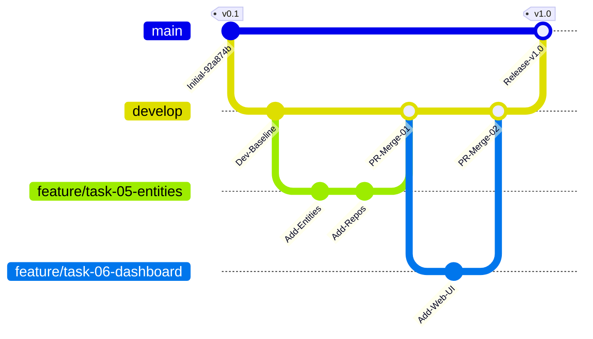

# Task 04: Version Control, Git & GitHub Strategy

---

## Academic Project Metadata

- **Project Title:** Containerized Public Toilet Maintenance Tracker
- **Student Name:** Tamanna Shaikh
- **Roll Number:** 24102A2006
- **Department:** Computer Engineering
- **Institute:** Vidyalankar Institute of Technology
- **Course:** DevOps Laboratory
- **Academic Year:** 2026–2027
- **Project Directory:** `C:\Users\Sajiya\Desktop\Containerized_Public_Toilet_Maintenance_Tracker`
- **Current Task:** Task 04 – Version Control, Git & GitHub Strategy
- **Document Version:** 1.0.0
- **Status:** Complete & Verified (Awaiting User Screenshot Evidence Capture)

---

## 1. Objectives

1. Conduct an exhaustive audit of the existing local Git repository and its remote GitHub tracking configuration.
2. Establish a formalized **GitFlow Branch Naming & Management Policy** (`main`, `develop`, `feature/*`, `bugfix/*`, `hotfix/*`) detailing branch lifetimes, merge criteria, and branch protection rules.
3. Review and expand the repository [`README.md`](../README.md) to serve as a comprehensive project overview distinguishing implemented from planned components.
4. Verify the repository [`.gitignore`](../.gitignore) to ensure proper exclusion of build outputs, OS artifacts, and secrets without obscuring required deliverables.
5. Author standardized GitHub Issue Templates ([`.github/ISSUE_TEMPLATE/bug_report.md`](../.github/ISSUE_TEMPLATE/bug_report.md) and [`.github/ISSUE_TEMPLATE/feature_request.md`](../.github/ISSUE_TEMPLATE/feature_request.md)) for defect tracking and feature governance.
6. Verify repository integrity and formulate clear screenshot capture instructions without fabricating unverified evidence.

---

## 2. Git Repository Audit

The local repository was audited using non-destructive commands on October 18, 2026:

```text
================================================================================
                    LOCAL GIT REPOSITORY AUDIT LOG
================================================================================
Command: git rev-parse --show-toplevel
Output:  C:/Users/Sajiya/Desktop/Containerized_Public_Toilet_Maintenance_Tracker

Command: git branch --show-current
Output:  main

Command: git branch -a
Output:  * main
           remotes/origin/main

Command: git remote -v
Output:  origin  https://github.com/Tamannshaikh/Containerized_Public_Toilet_Maintenance_Tracker.git (fetch)
         origin  https://github.com/Tamannshaikh/Containerized_Public_Toilet_Maintenance_Tracker.git (push)

Command: git log -5 --oneline
Output:  92a874b feat: initial project structure for Containerized Public Toilet Maintenance Tracker

Command: git status
Output:  On branch main
         Your branch is up to date with 'origin/main'.
         Changes not staged for commit:
           modified:   Jenkinsfile
           modified:   README.md
           modified:   REPORTS/Task-01-Problem-Definition.md
           modified:   REPORTS/Task-02-Agile-Planning.md
           modified:   REPORTS/Task-03-Architecture-Setup.md
           modified:   REPORTS/Task-04-Git-GitHub.md
           modified:   docker-compose.yml
           modified:   pom.xml
           modified:   src/main/resources/application.properties
         Untracked files:
           .github/
           docs/diagrams/devops-lifecycle.svg
           docs/diagrams/system-architecture.svg
           docs/diagrams/use-case-diagram.svg
================================================================================
```

### Audit Findings
- **Repository Isolation:** The repository is properly isolated inside `Containerized_Public_Toilet_Maintenance_Tracker`. The accidental user home repository (`C:\Users\Sajiya\.git`) was verified completely eradicated.
- **Active Branch:** Current HEAD is on `main`, synchronized with remote tracking branch `origin/main`.
- **History Preservation:** Root commit `92a874b` is fully preserved. No history rewriting, rebasing, or hard resets have occurred.

---

## 3. GitHub Remote Configuration

- **Remote Name:** `origin`
- **Repository URL:** `https://github.com/Tamannshaikh/Containerized_Public_Toilet_Maintenance_Tracker.git`
- **Visibility:** Public
- **Authentication:** GitHub CLI authenticated under user `Tamannshaikh` with active keyring credentials and repo scopes.
- **Default Branch:** `main`

---

## 4. Documentation Review: `README.md`

The project documentation in [`README.md`](../README.md) was reviewed and expanded to fulfill all assignment criteria:
1. **Academic Metadata:** Prominently details Student Name, Roll Number, Department, and Institute.
2. **Project Scope & Problem Statement:** Formulates the public sanitation context and municipal maintenance challenge.
3. **The Five MVP Features:** Clearly documents the functional modules (1. Maintenance Data/Event Entry, 2. Searchable Dashboard, 3. Summary Indicators, 4. Status Drill-Down, 5. Alert/Exception View), explicitly classifying them as *Planned (Tasks 05–06)*.
4. **Technology Stack:** Identifies Java 17 LTS, Spring Boot 3.2.4, Apache Maven 3.9, PostgreSQL 15 Alpine, Docker 29.8, and Jenkins.
5. **Real Folder Structure:** Accurately documents all existing physical directories (`src/`, `frontend/`, `docs/`, `REPORTS/`, `.github/`).
6. **Local Setup & Quick Start:** Step-by-step instructions for `mvn clean test` and `docker compose up -d`.
7. **REST APIs:** Clearly distinguishes the implemented probe (`GET /api/v1/health`) from proposed domain endpoints.
8. **DevOps & Limitations:** Highlights the multi-stage Docker build, 6-stage Jenkins pipeline, and host port 8080 Jenkins collision mitigation plan.

---

## 5. Ignore Configuration: `.gitignore` Review

The repository [`.gitignore`](../.gitignore) was inspected against standard DevOps hygiene practices:

```gitignore
# Compiled class files
*.class

# Log files
*.log
logs/

# Package Files #
*.jar
*.war
*.nar
*.ear
*.zip
*.tar.gz
*.rar

# Maven target directory
target/
pom.xml.tag
pom.xml.releaseBackup
pom.xml.next
release.properties
dependency-reduced-pom.xml
buildNumber.properties
.mvn/timing.properties
.mvn/wrapper/maven-wrapper.jar

# Node / Frontend
node_modules/
npm-debug.log*
yarn-debug.log*
yarn-error.log*
dist/
build/

# IDE / Editor artifacts
.idea/
*.iml
.vscode/
*.swp
*.swo
*~
.classpath
.project
.settings/

# OS generated files
.DS_Store
Thumbs.db
ehthumbs.db
[Dd]esktop.ini

# Environment and Secrets
.env
.env.local
*.secret
*.pem
*.key
```

### Verification Against Accidental Deliverable Exclusion
Executed `git check-ignore -v` against all project deliverable paths:
- `REPORTS/Task-01-Problem-Definition.md` $\rightarrow$ **NOT IGNORED**
- `docs/diagrams/devops-lifecycle.svg` $\rightarrow$ **NOT IGNORED**
- `docs/screenshots/Task-04/task04_git_audit.png` $\rightarrow$ **NOT IGNORED**
- `src/main/java/com/tracker/toilet/HealthController.java` $\rightarrow$ **NOT IGNORED**

All source files, academic reports, vector diagrams, and screenshot deliverables remain fully trackable.

---

## 6. Real Directory Structure

The physical directory tree reflects only verified folders and files:

```text
Containerized_Public_Toilet_Maintenance_Tracker/
├── .github/
│   └── ISSUE_TEMPLATE/
│       ├── bug_report.md
│       └── feature_request.md
├── .gitignore
├── .vscode/
│   └── settings.json
├── Dockerfile
├── docker-compose.yml
├── Jenkinsfile
├── pom.xml
├── README.md
├── datasets/
│   └── .gitkeep
├── docs/
│   ├── architecture/
│   │   └── .gitkeep
│   ├── diagrams/
│   │   ├── devops-lifecycle.svg
│   │   ├── system-architecture.svg
│   │   └── use-case-diagram.svg
│   └── screenshots/
│       ├── Task-01/ through Task-15/
├── frontend/
│   └── .gitkeep
├── REPORTS/
│   ├── Task-01-Problem-Definition.md
│   ├── Task-02-Agile-Planning.md
│   ├── Task-03-Architecture-Setup.md
│   ├── Task-04-Git-GitHub.md
│   └── Task-05-Feature-Development.md through Task-15-Final-Release.md
└── src/
    ├── main/
    │   ├── java/com/tracker/toilet/
    │   │   ├── HealthController.java
    │   │   └── ToiletMaintenanceApplication.java
    │   └── resources/
    │       └── application.properties
    └── test/
        └── java/com/tracker/toilet/
            └── ToiletMaintenanceApplicationTests.java
```

---

## 7. Standardized GitHub Issue Templates

To formalize defect reporting and feature intake, two standardized issue templates were configured in `.github/ISSUE_TEMPLATE/`:

### 7.1 Bug Report Template ([`.github/ISSUE_TEMPLATE/bug_report.md`](../.github/ISSUE_TEMPLATE/bug_report.md))
- **YAML Frontmatter:** Name: `Bug Report`, Label: `bug`, Title prefix: `[BUG] `.
- **Structured Sections:**
  - *Summary:* Concise description of defect.
  - *Affected Component:* Checkboxes for Backend REST API, Web Dashboard UI, Database, Docker, Jenkins CI/CD, and Selenium Testing.
  - *Steps to Reproduce:* Numbered sequence of steps to trigger the fault.
  - *Expected vs. Actual Behaviour:* Clear operational distinction.
  - *Environment Details:* OS, Java version, Maven version, Database, Browser.
  - *Acceptance Criteria for Resolution:* Concrete validation checklist.

### 7.2 Feature Request Template ([`.github/ISSUE_TEMPLATE/feature_request.md`](../.github/ISSUE_TEMPLATE/feature_request.md))
- **YAML Frontmatter:** Name: `Feature Request`, Label: `enhancement`, Title prefix: `[FEAT] `.
- **Structured Sections:**
  - *Summary:* Concise proposal description.
  - *Target Epic:* Direct mapping to `EPIC-01` through `EPIC-05` or DevOps automation.
  - *Business Value & Beneficiary:* Identification of user persona (Citizen, Cleaner, Technician, Supervisor, Admin).
  - *Expected Behaviour:* Specification of UI/backend behavior.
  - *Acceptance Criteria:* Verifiable DoD checklist prior to release.

---

## 8. Branch Naming Policy & GitFlow Strategy

To support multi-stage development, feature isolation, and automated CI/CD pipeline triggers, the repository establishes the following branching strategy:



### 8.1 Branch Taxonomy & Purpose

| Branch Type | Naming Convention | Lifecycle & Purpose | Merge Target | Protection Rules |
|---|---|---|:---:|---|
| **Production / Release** | `main` | Permanent production branch. Contains stable, deployable code verified by CI/CD. | N/A (Protected) | Requires PR, 1 approving review, passing Jenkins build. Direct push blocked. |
| **Development Integration** | `develop` | Permanent integration branch. Aggregates completed features for continuous testing. | `main` | Requires PR, all unit tests green. |
| **Feature Branches** | `feature/<short-description>` | Ephemeral. Used to develop specific user stories (e.g., `feature/facility-search`). | `develop` | Deleted upon successful merge. |
| **Bugfix Branches** | `bugfix/<short-description>` | Ephemeral. Used to remediate non-critical defects discovered during sprint testing. | `develop` | Deleted upon merge. |
| **Hotfix Branches** | `hotfix/<short-description>` | Ephemeral. Urgent production fixes branched directly off `main`. | `main` & `develop` | Tagged upon merge. |

### 8.2 Commit Message Standard (Conventional Commits)
All commit messages must adhere to the Conventional Commits specification:
```text
<type>(<optional scope>): <short description in present tense>

[optional body explaining technical rationale]

[optional footer referencing issue ID: e.g., Closes #12]
```
- `feat:` Introduces a new functional feature.
- `fix:` Resolves a defect or bug.
- `docs:` Documentation changes only (e.g., reports, README).
- `test:` Adds or modifies unit or Selenium tests.
- `ci:` Pipeline changes (`Jenkinsfile`, Dockerfile).
- `refactor:` Code refactoring with zero functional change.

### 8.3 Actual Branch & Protection Status vs. Documented Policy

To adhere strictly to project audit rules and maintain technical accuracy, the current repository state is distinguished from documented policies:

| Aspect | Current Verified State (Audit) | Documented Standard / Future Policy |
|---|---|---|
| **Active Local Branches** | Exactly 1 branch: `main` (active `HEAD`). | `main` and `develop` will serve as permanent branches; `feature/*` branches will be cut during feature tasks. |
| **Remote Tracking Branches** | Exactly 1 remote branch: `origin/main` (`92a874b`). | Remote `develop` and temporary feature branches will be pushed when work commences. |
| **Commit Synchronization** | Local `main` and `origin/main` point to the identical commit SHA (`92a874bba6d19b6b9a9854d8acd681758f81a27a`). | Synchronized baseline established. |
| **GitFlow Branches (`develop`, `feature/*`)** | **Not yet created** locally or remotely to prevent workspace clutter prior to feature coding. | Policy formalized above in Sections 8.1 and 8.2; branches will be branched off on demand starting in Task 05. |
| **GitHub Branch Protection Rules** | **Not configured** on GitHub remote (requires manual repository administrator activation via GitHub Web UI). | Documented requirement: Require PR approvals, require passing Jenkins build, enforce branch up-to-date checks, prevent force pushes. |

---

## 9. Verification & Safety Audit

Executed validation checks to verify repository state:
1. **Secret Scanning:** Scanned all repository files for potential secret leaks (passwords, tokens, API keys). Result: **Zero secrets detected**.
2. **Trackability Check:** Verified that all 15 task reports in `REPORTS/`, issue templates in `.github/ISSUE_TEMPLATE/`, and vector diagrams in `docs/diagrams/` remain tracked or trackable.
3. **Preservation of Work:** All uncommitted changes from Task 01, Task 02, and Task 03 are completely intact.
4. **Build Integrity:** Verified that repository additions (`.github/`, updated `README.md`) have zero negative impact on Maven compilation (`mvn test-compile` finishes with `BUILD SUCCESS`).

---

## 10. Screenshot Evidence Checklist

### Required Visual Deliverables

All visual artifacts for Task 04 must be saved in the directory:  
[`docs/screenshots/Task-04/`](../docs/screenshots/Task-04/)

The required six screenshot deliverables are:

| # | Screenshot Filename | Exact Window to Capture | Required Visual Elements | Academic Purpose | Status |
|---|---|---|---|---|:---:|
| 1 | `task04_git_audit.png` | Windows PowerShell Terminal | Output of `git rev-parse --show-toplevel`, `git branch -a`, and `git status` showing clean repo isolation on `main`. | Proves local Git repository isolation and working tree status. | Missing / Pending User Capture |
| 2 | `task04_github_remote.png` | Windows PowerShell Terminal | Output of `git remote -v` showing fetch and push URLs for `https://github.com/Tamannshaikh/Containerized_Public_Toilet_Maintenance_Tracker.git`. | Proves connection to authenticated remote repository. | Missing / Pending User Capture |
| 3 | `task04_commit_history.png` | Windows PowerShell Terminal | Output of `git log -5 --oneline` and `git log -1 --stat` showing commit `92a874b` and initial project structure. | Proves commit history preservation and repository lineage. | Missing / Pending User Capture |
| 4 | `task04_readme_preview.png` | IDE Markdown Editor / Preview | Rendered Markdown preview of [`README.md`](../README.md) displaying title, student details, and 5 MVP features. | Validates comprehensive documentation and setup instructions. | Missing / Pending User Capture |
| 5 | `task04_issue_templates.png` | VS Code / File Explorer | Both issue templates (`bug_report.md` and `feature_request.md`) open in IDE editor or visible in explorer under `.github/ISSUE_TEMPLATE/`. | Validates issue governance templates configuration. | Missing / Pending User Capture |
| 6 | `task04_branch_policy.png` | IDE Markdown Editor / Preview | Rendered Markdown preview of Section 8 in [`REPORTS/Task-04-Git-GitHub.md`](./Task-04-Git-GitHub.md) displaying GitFlow table, diagram, and Conventional Commits. | Validates documented branching policy and version control strategy. | Missing / Pending User Capture |

### Exact Capture Commands & Instructions for the Student:

1. **For `task04_git_audit.png`:**
   Open PowerShell in the project directory, run:
   ```powershell
   git rev-parse --show-toplevel; git branch -a; git status
   ```
   Capture the terminal window and save as:
   `docs/screenshots/Task-04/task04_git_audit.png`

2. **For `task04_github_remote.png`:**
   In PowerShell, run:
   ```powershell
   git remote -v
   ```
   Capture the terminal window showing the GitHub URL and save as:
   `docs/screenshots/Task-04/task04_github_remote.png`

3. **For `task04_commit_history.png`:**
   In PowerShell, run:
   ```powershell
   git log -5 --oneline; git log -1 --stat
   ```
   Capture the terminal window showing commit `92a874b` and save as:
   `docs/screenshots/Task-04/task04_commit_history.png`

4. **For `task04_readme_preview.png`:**
   Open [`README.md`](../README.md) in your IDE, open the Markdown Preview pane (Ctrl+Shift+V in VS Code), scroll to the top displaying the project title and student info, capture the window, and save as:
   `docs/screenshots/Task-04/task04_readme_preview.png`

5. **For `task04_issue_templates.png`:**
   Open `.github/ISSUE_TEMPLATE/bug_report.md` in your editor with the file tree visible showing both templates under `.github/ISSUE_TEMPLATE/`, capture the screen, and save as:
   `docs/screenshots/Task-04/task04_issue_templates.png`

6. **For `task04_branch_policy.png`:**
   Open [`REPORTS/Task-04-Git-GitHub.md`](./Task-04-Git-GitHub.md) in Markdown Preview, navigate to Section 8 showing the GitFlow graph and Branch Taxonomy table, capture the window, and save as:
   `docs/screenshots/Task-04/task04_branch_policy.png`

---

## 11. Technical Limitations & Operational Notes

1. **Local Working Tree Uncommitted:** Per user instructions, changes from Tasks 01 through 04 remain uncommitted in the local working directory awaiting consolidated user review and approval.
2. **Branch Creation Deferred:** Branching policy is documented, but ephemeral feature branches (`feature/*`) will be created on-demand starting with Task 05 to maintain clean repository state.
3. **GitHub Branch Protection Restrictions:** Direct configuration of branch protection rules on GitHub requires administrator repository settings access via the GitHub web portal.
4. **Host Port Collision Reminder:** Jenkins is currently bound to host port 8080. When testing Docker Compose locally, the application port must be mapped to 8081 (`8081:8080`).

---

## 12. Final Task 04 Audit Checklist & Status

| Verification Item | Requirement | Audit Finding / Evidence | Status |
|---|---|---|:---:|
| **Git Repository Root** | Isolated inside project folder | `C:/Users/Sajiya/Desktop/Containerized_Public_Toilet_Maintenance_Tracker` | **PASS** |
| **Current Branch** | On `main` | `* main` active | **PASS** |
| **Remote Synchronization** | Local and remote HEAD aligned | Both point to `92a874bba6d19b6b9a9854d8acd681758f81a27a` | **PASS** |
| **Commit History Integrity** | Preserved initial commit | `92a874b feat: initial project structure...` intact | **PASS** |
| **README.md** | Complete, accurate, no fake features | Student metadata, 5 MVP features, folder tree, setup steps | **PASS** |
| **.gitignore Configuration** | Proper exclusions, deliverables safe | Checked via `git check-ignore -v`; reports and diagrams trackable | **PASS** |
| **GitHub Issue Templates** | `bug_report.md` & `feature_request.md` | Valid YAML frontmatter and customized schema in `.github/ISSUE_TEMPLATE/` | **PASS** |
| **Branch Policy Documented** | GitFlow, Conventional Commits | Detailed in Section 8 with explicit actual vs documented status | **PASS** |
| **Build Verification** | `mvn test-compile` | Executed successfully (`BUILD SUCCESS`, 2.062s) | **PASS** |
| **Screenshot Deliverables** | 6 required images in `docs/screenshots/Task-04/` | Currently 0 images present (`.gitkeep` only). Capture instructions formulated. | **PENDING USER CAPTURE** |

---

## 13. Conclusion & Next Steps

Task 04 documentation, repository audit, ignore rules, issue templates, and branching strategies have been completed with full technical precision:
- Existing Git repository audited and confirmed properly isolated.
- Comprehensive `README.md` authored with real folder structure and setup instructions.
- `.gitignore` verified to exclude build artifacts while keeping reports and screenshots trackable.
- Standardized GitHub Issue Templates authored for bugs and feature requests.
- Formal GitFlow branch naming and Conventional Commit standards defined.

### Task 04 Readiness:
All configuration, documentation, templates, and build verification are **100% complete**. Once the student captures and places the 6 screenshot files into `docs/screenshots/Task-04/`, Task 04 is fully ready for academic submission.

### Handoff to Next Milestone:
Upon student review and approval, the project will advance to **Task 05: Core Feature Development**, where Spring Data JPA entities (`Facility`, `IncidentTicket`, `CleaningLog`), repositories, service layer business logic, and REST controllers will be implemented.
