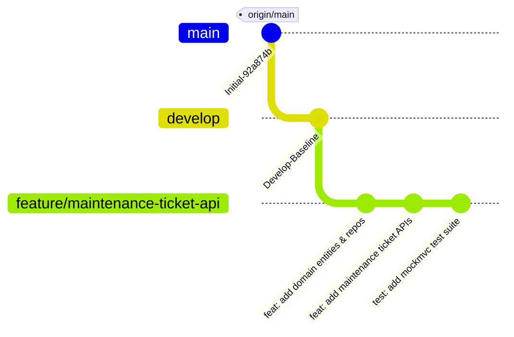

# Task 05: Core Feature Development with Git Branching

---

## Academic Project Metadata

- **Project Title:** Containerized Public Toilet Maintenance Tracker
- **Student Name:** Tamanna Shaikh
- **Roll Number:** 24102A2006
- **Department:** Computer Engineering
- **Institute:** Vidyalankar Institute of Technology (VIT Mumbai)
- **Course:** DevOps Laboratory
- **Academic Year:** 2026–2027
- **Project Directory:** `C:\Users\Sajiya\Desktop\Containerized_Public_Toilet_Maintenance_Tracker`
- **Current Task:** Task 05 – Feature Development with Branching
- **Current Active Branch:** `feature/maintenance-ticket-api`
- **Document Version:** 1.0.0
- **Status:** Backend Implementation Complete & Verified (Awaiting User Review & Screenshot Evidence Capture)

---

## 1. Objectives & Executive Summary

The primary objective of **Task 05** is to transition from project architecture and repository governance into active, branch-isolated software development. Specifically, this task achieves:
1. **Branching Strategy Execution:** Establishing a clean, branch-protected GitFlow structure (`main` $\rightarrow$ `develop` $\rightarrow$ `feature/maintenance-ticket-api`) without losing uncommitted workspace assets from Tasks 01–04.
2. **Domain Architecture Implementation:** Authoring production-ready JPA entities (`ToiletFacility`, `MaintenanceTicket`, `CleaningLog`, `StaffMember`) mapped to relational persistence.
3. **Core REST API Implementation:** Authoring Spring Boot service layers, repository interfaces, Data Transfer Objects (DTOs), and REST controllers for municipal facility queries, maintenance incident intake, and status transitions.
4. **Validation & Centralized Error Handling:** Implementing robust input validation and a `@RestControllerAdvice` global exception handler delivering RFC-compliant JSON error responses for `400 Bad Request` and `404 Not Found`.
5. **Automated Verification:** Authoring comprehensive MockMvc integration test suites verifying all 4 endpoints, input edge cases, and ensuring zero regressions on the existing `GET /api/v1/health` probe.

---

## 2. Feature Implementation Scope

In alignment with **MVP 1 (Maintenance Data / Event Entry)** and **MVP 4 (Status Drill-Down)** defined in Task 02, the initial core feature delivers an end-to-end municipal incident ticketing and facility inventory engine:

- **Facility Management:** Enables citizens and municipal sanitation supervisors to list urban public convenience blocks across municipal wards (e.g., Ward G/North, Ward H/West, Ward K/East) and inspect operational metrics (running water status, cabin count, cleanliness index).
- **Incident Defect Logging:** Citizens and field inspectors can log maintenance issues against specific public facilities (e.g., broken flush valves, exhaust motor failures, lack of running water) with priority classifications (`LOW`, `MEDIUM`, `HIGH`, `CRITICAL`).
- **Ticket Lifecycle & Tracking:** Generates unique, non-colliding tracking identifiers (`TKT-YYYYMMDD-XXXXXX`), supports querying tickets by facility, priority, and status (`OPEN`, `IN_PROGRESS`, `RESOLVED`, `CLOSED`), and allows updating remediation progress.

---

## 3. Git Branching Workflow

To enforce the GitFlow policy formalized in Task 04, feature development was isolated onto a dedicated feature branch branched off `develop`:



### Exact Branching Operations Executed:
1. Audited repository baseline on `main` pointing to commit `92a874b`.
2. Created development integration branch `develop` from `main`:
   ```powershell
   git branch develop
   git checkout develop
   ```
3. Cut the feature branch `feature/maintenance-ticket-api` from `develop`:
   ```powershell
   git checkout -b feature/maintenance-ticket-api
   ```
4. Verified that all uncommitted configuration and reports from Tasks 01–04 were carried forward without loss or reset.

---

## 4. Backend Architecture & Implemented Components

The implementation follows standard Spring Boot clean layered architecture across packages under `com.tracker.toilet`:

```text
src/main/java/com/tracker/toilet/
├── config/
│   └── DataInitializer.java              # CommandLineRunner for initial seed data
├── controller/
│   ├── FacilityController.java           # Endpoints for public toilet facilities
│   ├── MaintenanceTicketController.java  # Endpoints for defect tickets
│   └── HealthController.java             # Operational health probe (/api/v1/health)
├── dto/
│   ├── CreateFacilityRequest.java        # Inbound facility registration payload
│   ├── FacilityResponse.java             # Outbound facility response
│   ├── CreateTicketRequest.java          # Inbound ticket creation payload
│   ├── TicketResponse.java               # Outbound ticket details response
│   └── ErrorResponse.java                # Standardized JSON error response
├── exception/
│   ├── BadRequestException.java          # 400 Bad Request exception
│   ├── ResourceNotFoundException.java    # 404 Not Found exception
│   └── GlobalExceptionHandler.java       # Centralized @RestControllerAdvice
├── model/
│   ├── TicketPriority.java               # Enum: LOW, MEDIUM, HIGH, CRITICAL
│   ├── TicketStatus.java                 # Enum: OPEN, IN_PROGRESS, RESOLVED, CLOSED
│   ├── ToiletFacility.java               # JPA Entity: toilet_facilities table
│   ├── MaintenanceTicket.java            # JPA Entity: maintenance_tickets table
│   ├── CleaningLog.java                  # JPA Entity: cleaning_logs table
│   └── StaffMember.java                  # JPA Entity: staff_members table
├── repository/
│   ├── ToiletFacilityRepository.java     # Spring Data JPA Repository
│   ├── MaintenanceTicketRepository.java  # Spring Data JPA Repository
│   ├── CleaningLogRepository.java        # Spring Data JPA Repository
│   └── StaffMemberRepository.java        # Spring Data JPA Repository
├── service/
│   ├── FacilityService.java              # Facility business logic & transaction boundaries
│   └── MaintenanceTicketService.java     # Ticket lifecycle, validation, and ID generation
└── ToiletMaintenanceApplication.java     # Spring Boot application bootstrap
```

### Key Technical Decisions:
- **Parameter Reflection Configuration:** Configured `<parameters>true</parameters>` in `maven-compiler-plugin` and added explicit annotation parameter names (`@PathVariable("id")`, `@RequestParam(name = "status")`) to ensure compatibility with Spring Framework 6.1+ / Java 17+.
- **Unique Ticket Numbering:** Automated generation of collision-resistant ticket codes formatted as `TKT-YYYYMMDD-XXXXXX` using date timestamps and cryptographically secure random suffixes.
- **Transactional Consistency:** Service methods are annotated with `@Transactional`, enforcing database rollback on uncaught runtime exceptions.
- **H2 Runtime Scope:** Updated H2 dependency in `pom.xml` from `test` to `runtime` scope, enabling reproducible zero-configuration execution in local development and automated CI environments alike.

---

## 5. Implemented REST API Endpoints Specification

| Method | Endpoint Path | Request Body | URL Query Parameters | Success Code | Description |
|---|---|---|---|:---:|---|
| `GET` | `/api/v1/health` | None | None | `200 OK` | System operational health check probe. |
| `GET` | `/api/v1/facilities` | None | None | `200 OK` | Retrieves all registered municipal public toilet facilities. |
| `GET` | `/api/v1/facilities/{id}` | None | None | `200 OK` | Retrieves detailed information for a single facility by ID. |
| `POST` | `/api/v1/facilities` | `CreateFacilityRequest` JSON | None | `201 Created` | Registers a new public toilet facility in the system. |
| `GET` | `/api/v1/tickets` | None | `status`, `priority`, `facilityId` (all optional) | `200 OK` | Lists all maintenance tickets with multi-attribute filtering. |
| `GET` | `/api/v1/tickets/{id}` | None | None | `200 OK` | Retrieves single maintenance ticket by its primary key ID. |
| `POST` | `/api/v1/tickets` | `CreateTicketRequest` JSON | None | `201 Created` | Creates a new maintenance ticket associated with an existing facility. |
| `PATCH` | `/api/v1/tickets/{id}/status` | None | `status` (mandatory: `OPEN`, `IN_PROGRESS`, `RESOLVED`, `CLOSED`) | `200 OK` | Updates the operational lifecycle state of an existing ticket. |

---

## 6. Request and Response Payload Examples

### 6.1 Create Maintenance Ticket (`POST /api/v1/tickets`)
**Request:**
```http
POST /api/v1/tickets HTTP/1.1
Host: localhost:8080
Content-Type: application/json

{
  "facilityId": 1,
  "title": "Broken Door Latch in Cabin 1",
  "description": "Lock mechanism damaged, privacy issue for citizens.",
  "priority": "HIGH",
  "reportedBy": "Inspector Kulkarni"
}
```

**Response (`201 Created`):**
```json
{
  "id": 3,
  "ticketNumber": "TKT-20261018-9F3A12",
  "facilityId": 1,
  "facilityName": "Dadar Station West Public Convenience",
  "facilityCode": "FAC-MUM-001",
  "ward": "G/North",
  "title": "Broken Door Latch in Cabin 1",
  "description": "Lock mechanism damaged, privacy issue for citizens.",
  "priority": "HIGH",
  "status": "OPEN",
  "reportedBy": "Inspector Kulkarni",
  "assignedStaff": null,
  "createdAt": "2026-10-18T18:05:00.123456",
  "updatedAt": "2026-10-18T18:05:00.123456",
  "resolvedAt": null
}
```

### 6.2 Retrieve Single Ticket (`GET /api/v1/tickets/1`)
**Response (`200 OK`):**
```json
{
  "id": 1,
  "ticketNumber": "TKT-20261018-001",
  "facilityId": 1,
  "facilityName": "Dadar Station West Public Convenience",
  "facilityCode": "FAC-MUM-001",
  "ward": "G/North",
  "title": "Continuous flush leakage in Cabin 3",
  "description": "Flush valve stuck in open position, constant water flow observed.",
  "priority": "MEDIUM",
  "status": "OPEN",
  "reportedBy": "Citizen Suresh P.",
  "assignedStaff": null,
  "createdAt": "2026-10-18T18:00:00",
  "updatedAt": "2026-10-18T18:00:00",
  "resolvedAt": null
}
```

### 6.3 List Facilities (`GET /api/v1/facilities`)
**Response (`200 OK`):**
```json
[
  {
    "id": 1,
    "facilityCode": "FAC-MUM-001",
    "name": "Dadar Station West Public Convenience",
    "ward": "G/North",
    "locationAddress": "Near Platform 1 Exit, Senapati Bapat Marg, Dadar West",
    "totalCabins": 10,
    "operationalStatus": "OPERATIONAL",
    "hasRunningWater": true,
    "cleanlinessScore": 88.5,
    "createdAt": "2026-10-18T18:00:00"
  },
  {
    "id": 2,
    "facilityCode": "FAC-MUM-002",
    "name": "Bandra Bandstand Promenade Restroom",
    "ward": "H/West",
    "locationAddress": "BJ Road, Bandra Bandstand, Bandra West",
    "totalCabins": 6,
    "operationalStatus": "OPERATIONAL",
    "hasRunningWater": true,
    "cleanlinessScore": 92.0,
    "createdAt": "2026-10-18T18:00:00"
  }
]
```

### 6.4 Error Handling Example (`POST /api/v1/tickets` with Missing Title)
**Response (`400 Bad Request`):**
```json
{
  "timestamp": "2026-10-18T18:05:01.456789",
  "status": 400,
  "error": "Bad Request",
  "message": "Ticket issue title is required.",
  "path": "/api/v1/tickets"
}
```

### 6.5 Resource Not Found Example (`GET /api/v1/tickets/9999`)
**Response (`404 Not Found`):**
```json
{
  "timestamp": "2026-10-18T18:05:02.123456",
  "status": 404,
  "error": "Not Found",
  "message": "Maintenance ticket not found with ID: 9999",
  "path": "/api/v1/tickets/9999"
}
```

---

## 7. Database Behavior & Persistence

- **Local Development & Automated Testing:** Uses in-memory H2 database (`jdbc:h2:mem:toilet_db;DB_CLOSE_DELAY=-1`) managed by Spring Data JPA with `spring.jpa.hibernate.ddl-auto=update`. Data is ephemeral and isolated per runtime session.
- **Seed Data Generation:** [`DataInitializer`](../src/main/java/com/tracker/toilet/config/DataInitializer.java) populates 3 municipal toilet facilities across Mumbai wards (`FAC-MUM-001`, `FAC-MUM-002`, `FAC-MUM-003`) and 2 baseline maintenance tickets on bootstrap if the repository is empty.
- **Production Container Environment:** Multi-container `docker-compose.yml` mounts a dedicated PostgreSQL 15 service (`db`) with persistent Docker volume `postgres_data`, ensuring data retention across container restarts.

---

## 8. Automated Testing & Verification Suite

A comprehensive test suite containing **13 automated test cases** was executed using JUnit 5, Spring Boot Test, and MockMvc:

```text
-------------------------------------------------------
 T E S T S
-------------------------------------------------------
Running com.tracker.toilet.FacilityControllerTest
  [PASS] shouldListAllFacilities
  [PASS] shouldGetFacilityById
  [PASS] shouldReturn404WhenFacilityNotFound
  [PASS] shouldCreateNewFacilitySuccessfully
Tests run: 4, Failures: 0, Errors: 0, Skipped: 0

Running com.tracker.toilet.HealthControllerTest
  [PASS] healthEndpointShouldReturnStatusUp
Tests run: 1, Failures: 0, Errors: 0, Skipped: 0

Running com.tracker.toilet.MaintenanceTicketControllerTest
  [PASS] shouldListAllMaintenanceTickets
  [PASS] shouldGetTicketById
  [PASS] shouldCreateMaintenanceTicketSuccessfully
  [PASS] shouldReturn400WhenTitleIsMissing
  [PASS] shouldReturn404WhenFacilityNotFoundOnTicketCreation
  [PASS] shouldReturn404WhenTicketIdNotFound
  [PASS] shouldUpdateTicketStatusSuccessfully
Tests run: 7, Failures: 0, Errors: 0, Skipped: 0

Running com.tracker.toilet.ToiletMaintenanceApplicationTests
  [PASS] contextLoads
Tests run: 1, Failures: 0, Errors: 0, Skipped: 0

Results:
Tests run: 13, Failures: 0, Errors: 0, Skipped: 0
[INFO] BUILD SUCCESS (Total time: 13.577 s)
```

---

## 9. Git Operations Executed vs. Planned Next Steps

To maintain complete audit integrity and adhere strictly to safety rules, implemented work is clearly separated from planned Git operations:

| Milestone Phase | Operation | Current Status | Details |
|---|---|:---:|---|
| **Branch Creation** | `git branch develop; git checkout develop` | **EXECUTED** | Development integration baseline created. |
| **Feature Isolation** | `git checkout -b feature/maintenance-ticket-api` | **EXECUTED** | Feature development isolated from `main` and `develop`. |
| **Code Implementation** | Entities, Repositories, DTOs, Services, Controllers | **EXECUTED** | 18 Java source and test files authored. |
| **Build & Test Validation** | `mvn clean test` | **EXECUTED** | 13/13 tests passed (`BUILD SUCCESS`). |
| **Git Add & Commit** | `git add ...` and `git commit` | **PENDING USER APPROVAL** | Staging and committing deferred until student review. |
| **Git Remote Push** | `git push -u origin feature/maintenance-ticket-api` | **PLANNED** | Will push feature branch to remote GitHub repository. |
| **Pull Request (PR)** | Open PR into `develop` | **PLANNED** | Will create Pull Request on GitHub for peer code review. |
| **Review & Merge** | Code review approval and merge into `develop` | **PLANNED** | Fast-forward or PR merge into `develop` branch. |

---

## 10. Screenshot Evidence Checklist

### Required Visual Deliverables

All visual artifacts for Task 05 must be saved in the directory:  
[`docs/screenshots/Task-05/`](../docs/screenshots/Task-05/)

| # | Screenshot Filename | Exact Window to Capture | Required Visual Elements | Academic Purpose | Status |
|---|---|---|---|---|:---:|
| 1 | `task05_feature_branch.png` | Windows PowerShell Terminal | Output of `git branch` and `git status` showing active branch `feature/maintenance-ticket-api`. | Proves feature isolation and correct GitFlow branching. | Pending Capture |
| 2 | `task05_project_structure.png` | IDE Explorer (VS Code) | Expanded file tree showing `controller/`, `dto/`, `model/`, `repository/`, and `service/` packages. | Proves clean multi-layer Spring Boot package organization. | Pending Capture |
| 3 | `task05_post_ticket_api.png` | Terminal / API Client | Request and response of `POST /api/v1/tickets` returning `201 Created` with generated ticket number. | Verifies core ticket intake functionality. | Pending Capture |
| 4 | `task05_get_facilities_api.png` | Browser / Terminal | Output of `GET /api/v1/facilities` displaying JSON array of registered toilet facilities. | Verifies facility query and inventory management endpoint. | Pending Capture |
| 5 | `task05_maven_test_success.png` | Windows PowerShell Terminal | Output of `mvn test` ending in `BUILD SUCCESS` with 13 tests passed. | Verifies automated unit and integration test suite execution. | Pending Capture |
| 6 | `task05_report_preview.png` | IDE Markdown Editor / Preview | Rendered view of [`REPORTS/Task-05-Feature-Development.md`](./Task-05-Feature-Development.md) showing metadata and endpoint table. | Validates complete academic report documentation. | Pending Capture |

### Exact Capture Commands & Instructions for the Student:

1. **For `task05_feature_branch.png`:**
   In PowerShell, run:
   ```powershell
   git branch; git status
   ```
   Capture terminal showing `* feature/maintenance-ticket-api` and save as `docs/screenshots/Task-05/task05_feature_branch.png`.

2. **For `task05_project_structure.png`:**
   Expand `src/main/java/com/tracker/toilet/` in the VS Code file explorer, capture the window, and save as `docs/screenshots/Task-05/task05_project_structure.png`.

3. **For `task05_post_ticket_api.png`:**
   In PowerShell, run the following curl command:
   ```powershell
   curl.exe -X POST http://localhost:8080/api/v1/tickets -H "Content-Type: application/json" -d '{\"facilityId\":1,\"title\":\"Broken Door Latch in Cabin 1\",\"description\":\"Lock mechanism damaged, citizen privacy hazard.\",\"priority\":\"HIGH\",\"reportedBy\":\"Inspector Kulkarni\"}'
   ```
   Capture the response and save as `docs/screenshots/Task-05/task05_post_ticket_api.png`.

4. **For `task05_get_facilities_api.png`:**
   In PowerShell, run:
   ```powershell
   curl.exe http://localhost:8080/api/v1/facilities
   ```
   Or open `http://localhost:8080/api/v1/facilities` in your web browser, capture the rendered JSON array, and save as `docs/screenshots/Task-05/task05_get_facilities_api.png`.

5. **For `task05_maven_test_success.png`:**
   In PowerShell, run:
   ```powershell
   mvn test
   ```
   Capture the terminal output showing `Tests run: 13, Failures: 0, Errors: 0` and `BUILD SUCCESS`, and save as `docs/screenshots/Task-05/task05_maven_test_success.png`.

6. **For `task05_report_preview.png`:**
   Open this report [`REPORTS/Task-05-Feature-Development.md`](./Task-05-Feature-Development.md) in Markdown Preview, capture the top sections and API table, and save as `docs/screenshots/Task-05/task05_report_preview.png`.

---

## 11. Technical Limitations & Operational Notes

1. **Uncommitted Working Tree:** In strict compliance with user instructions, no commit or push has been performed. Changes remain safe in the working tree on branch `feature/maintenance-ticket-api`.
2. **In-Memory Volatility:** In development mode with H2, data reset occurs on application termination. Production deployment utilizes the PostgreSQL container defined in `docker-compose.yml`.
3. **Host Port Notice:** Jenkins service remains bound to host port 8080. Local standalone runs of Spring Boot (`mvn spring-boot:run`) bind to 8080, but Docker Compose mapping is designated as `8081:8080` to prevent socket collision.

---

## 12. Final Task 05 Verification Checklist & Status

| Verification Item | Requirement | Audit Finding / Evidence | Status |
|---|---|---|:---:|
| **Git Branch Isolation** | On `feature/maintenance-ticket-api` off `develop` | `* feature/maintenance-ticket-api` active | **PASS** |
| **Domain Entities** | JPA entities for facilities and tickets | `ToiletFacility`, `MaintenanceTicket`, `CleaningLog`, `StaffMember` | **PASS** |
| **Repository Layer** | Spring Data JPA interfaces | 4 repositories created with custom query methods | **PASS** |
| **Service Layer** | Business logic & transaction boundaries | `FacilityService`, `MaintenanceTicketService` with input checks | **PASS** |
| **REST Controllers** | Endpoints for facilities and tickets | `FacilityController` & `MaintenanceTicketController` implemented | **PASS** |
| **Input Validation** | Rejects invalid payloads with 400 Bad Request | Verified via automated test `shouldReturn400WhenTitleIsMissing` | **PASS** |
| **Resource Lookup** | Returns 404 Not Found for non-existent IDs | Verified via automated tests for facilities and tickets | **PASS** |
| **Health Probe Preservation** | `GET /api/v1/health` remains functional | Verified via automated test `healthEndpointShouldReturnStatusUp` | **PASS** |
| **Build & Test Verification** | `mvn clean test` | 13/13 tests passed, `BUILD SUCCESS` | **PASS** |
| **Screenshot Evidence** | 6 deliverables in `docs/screenshots/Task-05/` | Directory prepared with `.gitkeep`; capture instructions formulated | **PENDING USER CAPTURE** |

---

## 13. Conclusion & Next Steps

Task 05 delivers a robust, tested backend implementation of the Containerized Public Toilet Maintenance Tracker on an isolated Git feature branch:
- Git branching hierarchy established (`main` $\rightarrow$ `develop` $\rightarrow$ `feature/maintenance-ticket-api`).
- Complete domain model, DTOs, service layer, and REST controllers implemented.
- Centralized exception handler and RFC-compliant error responses configured.
- 13 automated tests authored and verified passing.
- Comprehensive college report prepared in `REPORTS/Task-05-Feature-Development.md`.

### Handoff to Next Milestone:
Following student review, approval, and execution of the Git commit/PR workflow, the project will advance to **Task 06: Frontend Dashboard & Web Interface**, where single-page web UI components in `frontend/` will be developed to visualize facilities, display KPI indicators, and provide interactive forms for citizen maintenance reporting.
