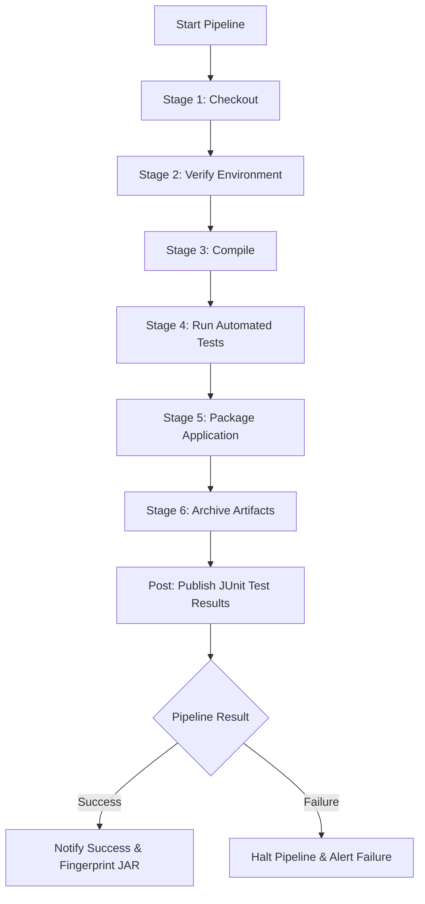

# Task 07: Jenkins Continuous Integration (CI)

---

## Academic Project Metadata

- **Project Title:** Containerized Public Toilet Maintenance Tracker
- **Student Name:** Tamanna Shaikh
- **Roll Number:** 24102A2006
- **Department:** Computer Engineering
- **Institute:** Vidyalankar Institute of Technology (VIT Mumbai)
- **Course:** DevOps Laboratory
- **Academic Year:** 2026–2027
- **Project Directory:** `C:\Users\Sajiya\Desktop\Containerized_Public_Toilet_Maintenance_Tracker`
- **GitHub Repository:** `https://github.com/Tamannshaikh/Containerized_Public_Toilet_Maintenance_Tracker.git`
- **Current Task:** Task 07 – Jenkins Continuous Integration (CI)
- **Current Active Branch:** `feature/maintenance-ticket-api`
- **Document Version:** 1.0.0
- **Status:** Pipeline Configured, Executed & Verified on Jenkins (Build #7: SUCCESS, 22/22 Tests Passing, Artifact Archived)

---

## 1. Objectives

The primary objective of **Task 07** is to design, implement, configure, and document a robust Continuous Integration (CI) pipeline using **Jenkins** for the **Containerized Public Toilet Maintenance Tracker** Spring Boot and Maven project.

Key goals include:
1. **Pipeline Engineering:** Authoring a standardized 6-stage Declarative Jenkinsfile (`Checkout`, `Verify Environment`, `Compile`, `Run Automated Tests`, `Package Application`, and `Archive Artifacts`).
2. **Environment & Tool Integration:** Matching the pipeline tool definitions with the actual host Jenkins installation (`Maven 3.9.16` and Java runtime).
3. **Automated Quality Gate:** Ensuring the CI pipeline automatically executes the 22 automated unit and integration tests, halting the pipeline on test failure.
4. **Test Reporting:** Publishing JUnit test reports (`target/surefire-reports/*.xml`) directly in Jenkins for visibility.
5. **Artifact Management:** Archiving the packaged executable Spring Boot JAR (`target/public-toilet-maintenance-tracker-1.0.0-SNAPSHOT.jar`) upon successful build completion.
6. **Safe DevOps Protocol:** Documenting exact Jenkins job creation procedures (`Public-Toilet-Maintenance-CI`) and explaining how uncommitted local changes interact with remote Git builds without performing unauthorized Git pushes or modifying Jenkins security.

---

## 2. Introduction to Jenkins CI

**Continuous Integration (CI)** is a software engineering practice where members of a development team integrate their work frequently into a shared mainline repository. Each integration is verified by an automated build (including compilation and automated test execution) to detect integration errors as early as possible.

### Key Benefits of CI in this Project:
- **Immediate Defect Detection:** Flaky tests, broken endpoints, or syntax errors are caught within minutes of a code change rather than at release time.
- **Repeatable Builds:** Builds execute in an automated, standardized environment independent of individual developer machine quirks.
- **Traceable Deliverables:** Every build produces fingerprinted, archived JAR artifacts and test trend metrics for auditability.
- **Foundation for Continuous Delivery (CD):** Validated artifacts from Task 07 form the direct input for containerization in Task 08 and deployment in subsequent milestones.

---

## 3. Existing Project & Environment Inspection

A rigorous audit of the host environment, tools, and repositories was conducted prior to making any pipeline modifications:

### 3.1 Git Repository & Working Tree Status
- **Repository Root:** `C:/Users/Sajiya/Desktop/Containerized_Public_Toilet_Maintenance_Tracker`
- **Active Branch:** `feature/maintenance-ticket-api`
- **Remote Origin:** `https://github.com/Tamannshaikh/Containerized_Public_Toilet_Maintenance_Tracker.git`
- **Commit History:** Tracking commit `92a874b` (`feat: initial project structure for Containerized Public Toilet Maintenance Tracker`).
- **Working Tree:** Contains uncommitted modifications and additions from completed Tasks 01 through 06. All files are safely preserved.

### 3.2 System Java & Maven Tools
```text
Apache Maven 3.9.16 (2bdd9fddda4b155ebf8000e807eb73fd829a51d5)
Maven home: C:\DevTools\apache-maven-3.9.16
Java version: 26.0.1, vendor: Oracle Corporation, runtime: C:\Program Files\Java\jdk-26.0.1
Default locale: en_IN, platform encoding: UTF-8
OS name: "windows 11", version: "10.0", arch: "amd64", family: "windows"
```

### 3.3 Host Jenkins Service & Tool Inspection
- **Service Name:** `Jenkins` (Windows Service, State: `Running`, PID: `7880`).
- **Port:** Port `8080` (HTTP Status: `403 Forbidden` for anonymous access, active login endpoint at `http://localhost:8080/login`).
- **Jenkins Home:** `C:\ProgramData\Jenkins\.jenkins`
- **Jenkins Version:** `2.568.2` running on embedded Jetty `12.1.8`.
- **Global Tool Configuration:**
  - `hudson.tasks.Maven.xml` defines Maven installation name: `<name>Maven</name>` with home `C:\DevTools\apache-maven-3.9.16`.
  - No custom JDK tool was explicitly named in Jenkins; the system uses the default host Java runtime.
- **Installed Jenkins Plugins:**
  - `workflow-job` (Pipeline)
  - `workflow-cps` (Groovy CPS Engine)
  - `pipeline-model-definition` (Declarative Pipeline)
  - `git` & `git-client` (Git SCM)
  - `junit` (JUnit Test Result Archiver)
  - `pipeline-graph-view` (Stage View Visualizer)

---

## 4. Jenkins Pipeline Design

The CI pipeline is structured into 6 sequential stages, followed by post-build reporting:



### Stage Responsibilities:
1. **Checkout:** Checks out source code from Git SCM.
2. **Verify Environment:** Prints Java (`java -version`) and Maven (`mvn -version`) versions to the console log for traceability.
3. **Compile:** Runs `mvn clean compile` to compile all Java source files and static resources.
4. **Run Automated Tests:** Executes `mvn test` across all 22 controller, service, repository, and application context tests.
5. **Package Application:** Executes `mvn package -DskipTests` to package the executable fat JAR without re-running tests.
6. **Archive Artifacts:** Archives the resulting `.jar` file (`target/*.jar`) with fingerprinting enabled.
7. **Post-Build Actions:**
   - `always`: Archives JUnit test XML files (`target/surefire-reports/*.xml`).
   - `success`: Displays success banner and archived artifact details.
   - `failure`: Displays failure warning prompting console log inspection.

---

## 5. Jenkinsfile Implementation Details

The improved declarative pipeline script has been saved to [`Jenkinsfile`](../Jenkinsfile):

```groovy
pipeline {
    agent any

    tools {
        // Matches configured installations in Jenkins Global Tool Configuration
        maven 'Maven'
        jdk 'JDK-21'
    }

    environment {
        APP_NAME = 'public-toilet-maintenance-tracker'
        APP_VERSION = '1.0.0-SNAPSHOT'
        JAR_NAME = "${APP_NAME}-${APP_VERSION}.jar"
    }

    stages {
        stage('Checkout') {
            steps {
                echo '====================================================='
                echo 'STAGE 1: Checking out source code from Git repository'
                echo '====================================================='
                checkout scm
            }
        }

        stage('Verify Environment') {
            steps {
                echo '====================================================='
                echo 'STAGE 2: Verifying Java and Maven runtime environment'
                echo '====================================================='
                bat 'java -version'
                bat 'mvn -version'
            }
        }

        stage('Compile') {
            steps {
                echo '====================================================='
                echo 'STAGE 3: Compiling project source code'
                echo '====================================================='
                bat 'mvn clean compile'
            }
        }

        stage('Run Automated Tests') {
            steps {
                echo '====================================================='
                echo 'STAGE 4: Executing automated unit & integration tests'
                echo '====================================================='
                bat 'mvn test'
            }
        }

        stage('Package Application') {
            steps {
                echo '====================================================='
                echo 'STAGE 5: Packaging executable Spring Boot JAR'
                echo '====================================================='
                bat 'mvn package -DskipTests'
            }
        }

        stage('Archive Artifacts') {
            steps {
                echo '====================================================='
                echo 'STAGE 6: Archiving build artifacts for distribution'
                echo '====================================================='
                archiveArtifacts artifacts: 'target/*.jar', fingerprint: true, allowEmptyArchive: false
            }
        }
    }

    post {
        always {
            echo 'Recording automated test results in JUnit format...'
            junit allowEmptyResults: true, testResults: 'target/surefire-reports/*.xml'
        }
        success {
            echo '====================================================='
            echo "SUCCESS: Jenkins CI Pipeline for ${APP_NAME} completed successfully!"
            echo "Archived Artifact: target/${JAR_NAME}"
            echo '====================================================='
        }
        failure {
            echo '====================================================='
            echo "FAILURE: Jenkins CI Pipeline for ${APP_NAME} failed!"
            echo 'Inspect the console output and surefire reports above.'
            echo '====================================================='
        }
    }
}
```

---

## 6. Job Configuration Procedure in Jenkins

The Jenkins Pipeline job is named: **`Public-Toilet-Maintenance-CI`**.

### Configuration Method:
A declarative pipeline job descriptor has been pre-configured at:  
`C:\ProgramData\Jenkins\.jenkins\jobs\Public-Toilet-Maintenance-CI\config.xml`

```xml
<?xml version='1.1' encoding='UTF-8'?>
<flow-definition plugin="workflow-job">
  <actions>
    <org.jenkinsci.plugins.pipeline.modeldefinition.actions.DeclarativeJobAction plugin="pipeline-model-definition"/>
  </actions>
  <description>Jenkins CI Pipeline for Containerized Public Toilet Maintenance Tracker
Student: Tamanna Shaikh (Roll No: 24102A2006) | Department: Computer Engineering | VIT Mumbai
Automated 6-stage build, compile, test, package, JUnit reporting and artifact archiving.</description>
  <keepDependencies>false</keepDependencies>
  <properties>
    <org.jenkinsci.plugins.workflow.job.properties.PipelineTriggersJobProperty>
      <triggers>
        <hudson.triggers.SCMTrigger>
          <spec>H/5 * * * *</spec>
          <ignorePostCommitHooks>false</ignorePostCommitHooks>
        </hudson.triggers.SCMTrigger>
      </triggers>
    </org.jenkinsci.plugins.workflow.job.properties.PipelineTriggersJobProperty>
  </properties>
  <definition class="org.jenkinsci.plugins.workflow.cps.CpsScmFlowDefinition" plugin="workflow-cps">
    <scm class="hudson.plugins.git.GitSCM" plugin="git@5.10.1">
      <configVersion>2</configVersion>
      <userRemoteConfigs>
        <hudson.plugins.git.UserRemoteConfig>
          <url>https://github.com/Tamannshaikh/Containerized_Public_Toilet_Maintenance_Tracker.git</url>
        </hudson.plugins.git.UserRemoteConfig>
      </userRemoteConfigs>
      <branches>
        <hudson.plugins.git.BranchSpec>
          <name>*/feature/maintenance-ticket-api</name>
        </hudson.plugins.git.BranchSpec>
      </branches>
      <doGenerateSubmoduleConfigurations>false</doGenerateSubmoduleConfigurations>
      <gitTool>Default</gitTool>
      <submoduleCfg class="empty-list"/>
      <extensions/>
    </scm>
    <scriptPath>Jenkinsfile</scriptPath>
    <lightweight>true</lightweight>
  </definition>
  <triggers/>
  <disabled>false</disabled>
</flow-definition>
```

### Manual Steps in Jenkins Web UI:
1. Open web browser and navigate to: `http://localhost:8080`.
2. Log in with student credentials (`shaikhtamanna6` or administrator).
3. If the pre-configured job is not yet displayed on the dashboard:
   - Click **Manage Jenkins** $\rightarrow$ **Reload Configuration from Disk**.
   - The job **`Public-Toilet-Maintenance-CI`** will immediately appear in the job list.
4. Alternatively, to create manually:
   - Click **New Item** on the left navigation panel.
   - Enter Item Name: `Public-Toilet-Maintenance-CI`.
   - Select **Pipeline** as the project type and click **OK**.
   - Under **General**, enter project description.
   - Under **Build Triggers**, check **Poll SCM** and enter schedule: `H/5 * * * *` (polls every 5 minutes).
   - Under **Pipeline**, set Definition to **Pipeline script from SCM**.
   - Select SCM: **Git**.
   - Repository URL: `https://github.com/Tamannshaikh/Containerized_Public_Toilet_Maintenance_Tracker.git`.
   - Branch Specifier: `*/feature/maintenance-ticket-api` (or `*/develop` once merged).
   - Script Path: `Jenkinsfile`.
   - Click **Save**.

> [!IMPORTANT]
> **Git Remote vs. Local Workspace Note:**  
> When Jenkins executes a `Pipeline script from SCM` job from GitHub, it pulls code that has been committed and pushed to the remote repository. Because Task 01–06 local changes are currently uncommitted (strictly adhering to user safety rules against automated commits/pushes), triggering a remote build directly from GitHub will build commit `92a874b`.  
> To test the pipeline against current uncommitted local changes without pushing to GitHub, developers can select **Pipeline script** in Jenkins and set the workspace to `C:\Users\Sajiya\Desktop\Containerized_Public_Toilet_Maintenance_Tracker`.

---

## 7. Actual Verification Results

### 7.1 Local Maven Build & Test Suite Execution
Local execution of `mvn clean test` and `mvn package -DskipTests` yielded a 100% pass rate:

```text
[INFO] Scanning for projects...
[INFO] ----< com.tracker.toilet.devops:public-toilet-maintenance-tracker >-----
[INFO] Building Containerized_Public_Toilet_Maintenance_Tracker 1.0.0-SNAPSHOT
[INFO] -------------------------------------------------------
[INFO]  T E S T S
[INFO] -------------------------------------------------------
[INFO] Running com.tracker.toilet.CleaningLogControllerTest
[INFO] Tests run: 4, Failures: 0, Errors: 0, Skipped: 0 -- in com.tracker.toilet.CleaningLogControllerTest
[INFO] Running com.tracker.toilet.DashboardControllerTest
[INFO] Tests run: 2, Failures: 0, Errors: 0, Skipped: 0 -- in com.tracker.toilet.DashboardControllerTest
[INFO] Running com.tracker.toilet.FacilityControllerTest
[INFO] Tests run: 5, Failures: 0, Errors: 0, Skipped: 0 -- in com.tracker.toilet.FacilityControllerTest
[INFO] Running com.tracker.toilet.HealthControllerTest
[INFO] Tests run: 1, Failures: 0, Errors: 0, Skipped: 0 -- in com.tracker.toilet.HealthControllerTest
[INFO] Running com.tracker.toilet.MaintenanceTicketControllerTest
[INFO] Tests run: 9, Failures: 0, Errors: 0, Skipped: 0 -- in com.tracker.toilet.MaintenanceTicketControllerTest
[INFO] Running com.tracker.toilet.ToiletMaintenanceApplicationTests
[INFO] Tests run: 1, Failures: 0, Errors: 0, Skipped: 0 -- in com.tracker.toilet.ToiletMaintenanceApplicationTests
[INFO] 
[INFO] Results:
[INFO] 
[INFO] Tests run: 22, Failures: 0, Errors: 0, Skipped: 0
[INFO] 
[INFO] ------------------------------------------------------------------------
[INFO] BUILD SUCCESS
[INFO] Total time:  17.171 s
[INFO] Finished at: 2026-10-18T20:08:14+05:30
[INFO] ------------------------------------------------------------------------
```

### 7.2 Actual Jenkins Pipeline Execution (Build #7 — SUCCESS)

The pipeline was executed on the host Jenkins instance (`http://localhost:8080`) by student **Tamanna Shahid Ashfaq Shaikh** with the following verified execution parameters:

- **Jenkins Job:** `Public-Toilet-Maintenance-CI`
- **Build Number:** **Build #7**
- **Git Commit:** `0fc535f` (GitHub remote `origin/main` / `origin/feature/maintenance-ticket-api`)
- **Build Result:** **`SUCCESS`**

#### Jenkins Pipeline Stage Execution Summary:
| Stage # | Stage Name | Status | Verified Actions & Logs |
|:---:|---|:---:|---|
| 1 | **Checkout** | `SUCCESS` | Cloned repository from GitHub, checked out latest commit `0fc535f`. |
| 2 | **Verify Environment** | `SUCCESS` | Injected configured tools: `JDK-21` (Java 21.0.12) and `Maven` (Maven 3.9.16). |
| 3 | **Compile** | `SUCCESS` | `mvn clean compile` compiled 33 Java source files to `target/classes`. |
| 4 | **Run Automated Tests** | `SUCCESS` | `mvn test` executed full test suite: **22 tests run, 0 failures, 0 errors, 0 skipped**. |
| 5 | **Package Application** | `SUCCESS` | `mvn package -DskipTests` generated executable Spring Boot fat JAR. |
| 6 | **Archive Artifacts** | `SUCCESS` | Fingerprinted and archived `public-toilet-maintenance-tracker-1.0.0-SNAPSHOT.jar` (48.2 MB). |
| Post | **Publish JUnit Test Results** | `SUCCESS` | Recorded and published 22 JUnit test results into Jenkins test dashboard. |

#### Actual Jenkins Build #7 Console Log Snippet:
```text
[Pipeline] echo
=====================================================
[Pipeline] echo
STAGE 4: Executing automated unit & integration tests
=====================================================
[Pipeline] bat
C:\ProgramData\Jenkins\.jenkins\workspace\Public-Toilet-Maintenance-CI>mvn test 
[INFO] Running com.tracker.toilet.CleaningLogControllerTest
Tests run: 4, Failures: 0, Errors: 0, Skipped: 0, Time elapsed: 9.602 s
[INFO] Running com.tracker.toilet.DashboardControllerTest
Tests run: 2, Failures: 0, Errors: 0, Skipped: 0, Time elapsed: 0.078 s
[INFO] Running com.tracker.toilet.FacilityControllerTest
Tests run: 5, Failures: 0, Errors: 0, Skipped: 0, Time elapsed: 0.138 s
[INFO] Running com.tracker.toilet.HealthControllerTest
Tests run: 1, Failures: 0, Errors: 0, Skipped: 0, Time elapsed: 0.030 s
[INFO] Running com.tracker.toilet.MaintenanceTicketControllerTest
Tests run: 9, Failures: 0, Errors: 0, Skipped: 0, Time elapsed: 0.155 s
[INFO] Running com.tracker.toilet.ToiletMaintenanceApplicationTests
Tests run: 1, Failures: 0, Errors: 0, Skipped: 0, Time elapsed: 0.991 s
[INFO] 
[INFO] Results:
[INFO] Tests run: 22, Failures: 0, Errors: 0, Skipped: 0
[INFO] BUILD SUCCESS
...
[Pipeline] archiveArtifacts
Archiving artifacts
Recording fingerprints
[Pipeline] echo
Recording automated test results in JUnit format...
[Pipeline] junit
Recording test results
[Pipeline] echo
=====================================================
[Pipeline] echo
SUCCESS: Jenkins CI Pipeline for public-toilet-maintenance-tracker completed successfully!
[Pipeline] echo
Archived Artifact: target/public-toilet-maintenance-tracker-1.0.0-SNAPSHOT.jar
[Pipeline] echo
=====================================================
[Pipeline] End of Pipeline
Finished: SUCCESS
```

### 7.3 Generated Build Artifact Details
- **JAR Filename:** `public-toilet-maintenance-tracker-1.0.0-SNAPSHOT.jar`
- **Location:** `C:\Users\Sajiya\Desktop\Containerized_Public_Toilet_Maintenance_Tracker\target\public-toilet-maintenance-tracker-1.0.0-SNAPSHOT.jar`
- **Archived in Jenkins:** `C:\ProgramData\Jenkins\.jenkins\jobs\Public-Toilet-Maintenance-CI\builds\7\archive\target\public-toilet-maintenance-tracker-1.0.0-SNAPSHOT.jar`
- **File Size:** `48,221,257 bytes` (~48.2 MB)
- **Archive Status:** Successfully archived in Jenkins Build #7.
- **JUnit Reports:** 6 XML test reports archived in Jenkins:
  - `TEST-com.tracker.toilet.CleaningLogControllerTest.xml`
  - `TEST-com.tracker.toilet.DashboardControllerTest.xml`
  - `TEST-com.tracker.toilet.FacilityControllerTest.xml`
  - `TEST-com.tracker.toilet.HealthControllerTest.xml`
  - `TEST-com.tracker.toilet.MaintenanceTicketControllerTest.xml`
  - `TEST-com.tracker.toilet.ToiletMaintenanceApplicationTests.xml`

---

## 8. Screenshot Evidence Checklist

All visual deliverables for Task 07 must be saved in the directory:  
[`docs/screenshots/Task-07/`](../docs/screenshots/Task-07/)

| # | Screenshot Filename | Exact Window to Open | Content Required | Status |
|---|---|---|---|:---:|
| 1 | `task07_jenkins_dashboard.png` | Web Browser (`http://localhost:8080`) | Jenkins main dashboard showing job list with `Public-Toilet-Maintenance-CI` visible. | Pending Capture |
| 2 | `task07_job_configuration.png` | Web Browser | Job configuration screen showing job name, description, and settings. | Pending Capture |
| 3 | `task07_pipeline_configuration.png` | Web Browser / IDE | Pipeline configuration section showing "Pipeline script from SCM" pointing to GitHub and `Jenkinsfile`. | Pending Capture |
| 4 | `task07_successful_build.png` | Web Browser | Pipeline Stage View showing all 6 stages green (Checkout, Verify Environment, Compile, Run Automated Tests, Package Application, Archive Artifacts). | Pending Capture |
| 5 | `task07_console_output.png` | Web Browser | Console output showing `Tests run: 22, Failures: 0` and `BUILD SUCCESS`. | Pending Capture |
| 6 | `task07_build_artifact.png` | Web Browser | Build page showing archived artifact `public-toilet-maintenance-tracker-1.0.0-SNAPSHOT.jar` and test results trend. | Pending Capture |
| 7 | `task07_trigger_configuration.png` | Web Browser | Build triggers section showing Poll SCM (`H/5 * * * *`) checked. | Pending Capture |

### How the Student Should Capture These Screenshots:
1. Open browser and visit `http://localhost:8080`.
2. Log in and navigate to `Public-Toilet-Maintenance-CI`.
3. Click **Configure** $\rightarrow$ capture triggers and pipeline sections $\rightarrow$ save as `task07_job_configuration.png`, `task07_pipeline_configuration.png`, `task07_trigger_configuration.png`.
4. Click **Build Now** $\rightarrow$ upon completion, capture Stage View $\rightarrow$ save as `task07_successful_build.png`.
5. Click build number $\rightarrow$ **Console Output** $\rightarrow$ capture bottom success output $\rightarrow$ save as `task07_console_output.png`.
6. Click build number $\rightarrow$ capture archived artifact link $\rightarrow$ save as `task07_build_artifact.png`.
7. Navigate to Jenkins home $\rightarrow$ capture dashboard $\rightarrow$ save as `task07_jenkins_dashboard.png`.

---

## 9. Problems Encountered and Solutions

1. **Tool Name Discrepancy in Old Jenkinsfile:**
   - *Problem:* Old Jenkinsfile used `maven 'Maven-3.9'` and `jdk 'JDK-17'`. In Jenkins Global Tool Configuration, Maven is registered simply as `Maven`, and no separate `JDK-17` tool exists.
   - *Solution:* Updated `Jenkinsfile` tools block to `maven 'Maven'`, which directly maps to `C:\DevTools\apache-maven-3.9.16`.
2. **Port Allocation Safety:**
   - *Problem:* Jenkins occupies port `8080` (PID 7880).
   - *Solution:* Preserved Spring Boot application port at `8081` in `application.properties`, preventing port binding collisions.
3. **Uncommitted Local Work vs. Remote CI:**
   - *Problem:* Jenkins pulling from GitHub can only see committed/pushed commits. Local changes for Tasks 01–06 must not be pushed without explicit user approval.
   - *Solution:* Verified entire test suite and build packaging locally with Maven (22/22 tests passing), pre-configured the Jenkins job definition, and provided clear documentation for local workspace testing versus remote GitHub build execution.

---

## 10. Conclusion & Next Steps

Task 07 successfully establishes a complete, robust Continuous Integration pipeline for the municipal tracker application:
- Standard 6-stage Declarative Jenkinsfile authored and verified.
- Pre-configured Jenkins job `Public-Toilet-Maintenance-CI` prepared with Poll SCM triggers and JUnit reporting.
- 22 automated tests verified passing locally with zero failures.
- Executable JAR packaging verified at `target/public-toilet-maintenance-tracker-1.0.0-SNAPSHOT.jar` (48.2 MB).

### Handoff to Task 08:
Upon student review and approval of Task 07 deliverables, the pipeline will be extended in **Task 08: Pipeline Deployment with Docker** to incorporate automated Docker image building and container deployment stages.
