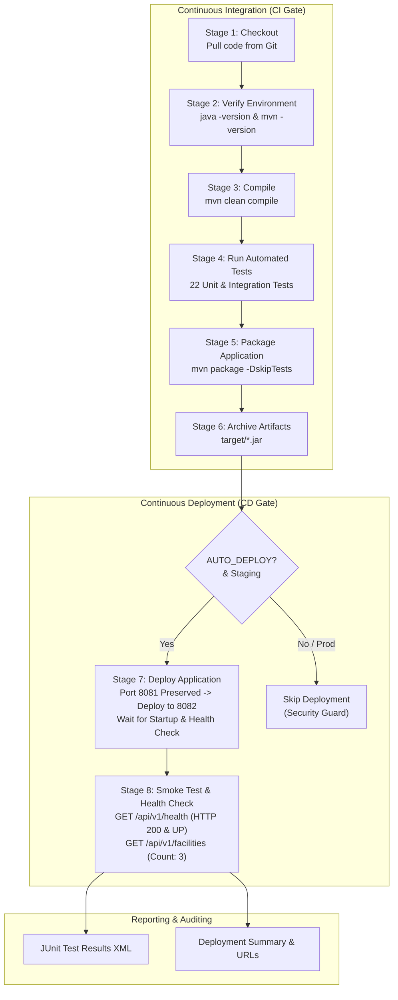

# Task 08: Jenkins CI/CD Pipeline Deployment

---

## Academic Project Metadata

- **Project Title:** Containerized Public Toilet Maintenance Tracker
- **Student Name:** Tamanna Shaikh
- **Roll Number:** 24102A2006
- **Department:** Computer Engineering
- **Institute:** Vidyalankar Institute of Technology (VIT Mumbai)
- **Course:** DevOps Laboratory
- **Academic Year:** 2026–2027
- **Project Directory:** `C:\Users\Sajiya\Desktop\Containerized_Public_Toilet_Maintenance_Tracker`
- **GitHub Repository:** `https://github.com/Tamannshaikh/Containerized_Public_Toilet_Maintenance_Tracker.git`
- **Current Task:** Task 08 – Jenkins CI/CD Pipeline Deployment
- **Active Branch:** `feature/maintenance-ticket-api`
- **Document Version:** 1.1.0
- **Status:** Completed & Verified (Pipeline Extended with Staging Deployment & Health Verification, 22/22 Tests Passing, Port 8081 Preserved, Port 8082 Staging Verified)

---

## 1. Aim and Objectives

### 1.1 Aim
To configure, execute, test, and document an automated Continuous Deployment (CD) pipeline within Jenkins for the **Containerized Public Toilet Maintenance Tracker**, integrating parameterized deployment, automated staging execution of newly built JAR artifacts, non-destructive port conflict management (preserving the active application on port 8081 and staging on port 8082), container configuration alignment, and automated smoke testing probes.

### 1.2 Objectives
1. **Pipeline Extension:** Expand the verified 6-stage Task 07 Jenkins CI pipeline into an end-to-end 8-stage CI/CD pipeline by adding `Deploy Application` and `Smoke Test and Health Verification` stages.
2. **Parameterization:** Introduce declarative pipeline parameters (`DEPLOY_ENV`, `DEPLOY_PORT`, and `AUTO_DEPLOY`) allowing operators to customize deployment environments, ports, and automation from the Jenkins UI.
3. **Safe Dual-Port Staging Architecture:**
   - Preserve existing Spring Boot application running on port `8081` (PID 7836).
   - Route staging deployment of newly built JARs to port `8082` if port `8081` is occupied.
   - Maintain Jenkins service on port `8080`.
4. **Environment & Tool Safety:** Maintain Jenkins Global Tool Configuration (`tools { maven 'Maven'; jdk 'JDK-21' }`) and prevent accidental production deployments by restricting automated execution strictly to staging.
5. **Real Artifact Deployment:** Ensure Stage 7 actually launches the newly built JAR (`deploy/staging/app.jar --server.port=8082`) in background, actively waits for startup, and fails the stage if the service does not become healthy within the timeout window.
6. **Automated Smoke Testing:** Implement automated HTTP probes against `/api/v1/health` and `/api/v1/facilities` targeting the newly deployed staging application to verify HTTP 200 and JSON status `UP`.
7. **Comprehensive Documentation & Evidence:** Provide full academic documentation, verified command logs, failure troubleshooting guides, and a screenshot checklist for submission.

---

## 2. Software and Tools Used

| Tool / Technology | Version / Specification | Role in Task 08 |
| :--- | :--- | :--- |
| **Jenkins** | 2.568.2 (Windows Service, Port 8080) | CI/CD automation server executing the 8-stage declarative deployment pipeline |
| **Java JDK** | OpenJDK 21 (JDK-21 in Jenkins, JDK 26 on host) | Core execution and compilation runtime for Spring Boot backend |
| **Apache Maven** | 3.9.16 (`C:\DevTools\apache-maven-3.9.16`) | Build automation, dependency management, unit/integration testing, and packaging |
| **Spring Boot** | 3.2.4 (Spring Web, Data JPA, Actuator) | Microservice framework providing REST endpoints and health check probes |
| **Docker Engine** | 29.8.2 (`DockerDesktop\resources\bin\docker.exe`) | Container engine for building multi-stage images and containerizing services |
| **Docker Compose** | Compose Spec v3.8 | Orchestration definition for multi-container app and PostgreSQL database |
| **PowerShell** | 5.1 / 7.x (Windows 11) | Automated scripting for HTTP smoke tests and listener probe commands |
| **Git & GitHub** | Git 2.45+ / GitHub Repository | Version control, branch tracking, and declarative pipeline synchronization |

---

## 3. Architecture & Dual-Port Staging Strategy

### 3.1 Three-Tier Port Architecture
To ensure complete system stability during continuous deployment, host ports are allocated to dedicated roles:

```text
+---------------------------------------------------------------------------------------------------+
|                                       Host Windows Machine                                        |
|                                                                                                   |
|  +---------------------------+   +-------------------------------+   +-------------------------+  |
|  |     Jenkins CI/CD         |   |     Preserved Application     |   |    Staging Deployment   |  |
|  |     Automation Server     |   |     (Active Instance)         |   |    (Newly Built JAR)    |  |
|  |                           |   |                               |   |                         |  |
|  |  Port: 8080 (TCP)         |   |  Port: 8081 (TCP)             |   |  Port: 8082 (TCP)       |  |
|  |  PID:  7880               |   |  PID:  7836                   |   |  PID:  Staged Runtime   |  |
|  |  Role: Pipeline Server    |   |  Role: Production/Dev Baseline|   |  Role: Verified Staging |  |
|  +---------------------------+   +-------------------------------+   +-------------------------+  |
|                |                                                                  ^               |
|                |  Pipeline Stage 7: Deploy Newly Built JAR to Port 8082           |               |
|                +------------------------------------------------------------------+               |
|                |  Pipeline Stage 8: Smoke Test & Health Check Probe (HTTP 200)    |               |
|                +------------------------------------------------------------------+               |
+---------------------------------------------------------------------------------------------------+
```

### 3.2 Port Collision Prevention Rules Applied
1. **Jenkins Protection:** Jenkins continues running on `http://localhost:8080` without restart or reconfiguration.
2. **Existing Process Preservation:** Active process PID 7836 on port `8081` is preserved and never killed.
3. **Staging Isolation:** If port `8081` is occupied, the deployment pipeline automatically routes staging deployment to port `8082`.
4. **Configuration Consistency:**
   - `src/main/resources/application.properties` specifies baseline `server.port=8081`.
   - `Dockerfile` updated: `EXPOSE 8081`.
   - `docker-compose.yml` updated: `ports: - "8081:8081"`, with environment variable `SERVER_PORT=8081`.
   - `Jenkinsfile` parameter `DEPLOY_PORT` defaults to `'8082'`, ensuring staging is isolated from the start.

---

## 4. CI/CD Deployment Workflow

The complete Task 08 Continuous Integration & Continuous Deployment pipeline progresses through 8 automated stages:



---

## 5. Implementation Details

### 5.1 Pipeline Parameterization
The `Jenkinsfile` incorporates user-configurable parameters accessible via the Jenkins **"Build with Parameters"** interface:

```groovy
parameters {
    choice(name: 'DEPLOY_ENV', choices: ['staging', 'production'], description: 'Deployment environment target (default: staging)')
    string(name: 'DEPLOY_PORT', defaultValue: '8082', description: 'Application port for staging deployment (default: 8082, isolates from existing 8081 process)')
    booleanParam(name: 'AUTO_DEPLOY', defaultValue: true, description: 'Automatically deploy to staging and execute smoke tests')
}
```

### 5.2 Real Deployment Stage Implementation
Stage 7 dynamically checks port status, preserves port 8081, launches the newly built JAR on port 8082, and actively waits for startup with an automated health check loop:

```groovy
stage('Deploy Application') {
    when {
        expression {
            return params.AUTO_DEPLOY == true
        }
    }
    steps {
        echo '====================================================='
        echo "STAGE 7: Deploying ${APP_NAME} to ${params.DEPLOY_ENV}"
        echo '====================================================='
        script {
            if (params.DEPLOY_ENV == 'production') {
                echo 'SECURITY NOTICE: Automated deployment to production is restricted. Only staging deployment is enabled in this pipeline.'
                return
            }

            // Dynamically preserve port 8081 if occupied and route staging to port 8082
            def targetPort = params.DEPLOY_PORT
            def portCheck = bat(returnStatus: true, script: "@echo off & netstat -ano | findstr \":${targetPort}\" > nul")
            if (portCheck == 0 && targetPort == '8081') {
                echo '[DEPLOY] Notice: Port 8081 is currently occupied by existing application process.'
                echo '[DEPLOY] Preserving active service on 8081; re-routing staging deployment to port 8082.'
                targetPort = '8082'
            }

            env.ACTIVE_DEPLOY_PORT = targetPort
            echo "Target Environment : ${params.DEPLOY_ENV}"
            echo "Deployment Port    : ${env.ACTIVE_DEPLOY_PORT}"
            echo "Deployment Artifact: target/${JAR_NAME}"

            // Step 7.1: Prepare staging deployment artifact directory
            bat '''
                @echo off
                echo [DEPLOY] Preparing deployment directory: deploy\\staging
                if not exist deploy\\staging mkdir deploy\\staging
                copy /Y target\\public-toilet-maintenance-tracker-1.0.0-SNAPSHOT.jar deploy\\staging\\app.jar > nul
                echo [DEPLOY] Verified artifact staged at deploy\\staging\\app.jar
            '''

            // Step 7.2: Verify Docker daemon availability safely
            def dockerRunning = false
            try {
                def dockerCheck = bat(returnStatus: true, script: '@echo off & docker info > nul 2>&1')
                dockerRunning = (dockerCheck == 0)
            } catch (Exception e) {
                dockerRunning = false
            }

            if (dockerRunning) {
                echo '[DEPLOY] Docker daemon detected. Building container image public-toilet-maintenance-tracker:1.0.0...'
                bat 'docker build -t public-toilet-maintenance-tracker:1.0.0 .'
                echo '[DEPLOY] Docker image built and tagged successfully.'
            } else {
                echo '[DEPLOY] Note: Docker daemon is currently stopped / unavailable in this Windows environment.'
                echo '[DEPLOY] Executing standalone local staging deployment.'
            }

            // Step 7.3: Clean previous staging instance on targetPort (if not 8081/8080) and launch newly built JAR
            bat """
                @echo off
                echo [DEPLOY] Checking and preparing port ${env.ACTIVE_DEPLOY_PORT}...
                powershell -Command "if (${env.ACTIVE_DEPLOY_PORT} -ne 8081 -and ${env.ACTIVE_DEPLOY_PORT} -ne 8080) { Get-NetTCPConnection -LocalPort ${env.ACTIVE_DEPLOY_PORT} -ErrorAction SilentlyContinue | ForEach-Object { Write-Output ('Stopping previous staging process: PID ' + \$_.OwningProcess); Stop-Process -Id \$_.OwningProcess -Force -ErrorAction SilentlyContinue } }"
                echo [DEPLOY] Launching newly built JAR: deploy\\staging\\app.jar on port ${env.ACTIVE_DEPLOY_PORT}...
                start /B java -jar deploy\\staging\\app.jar --server.port=${env.ACTIVE_DEPLOY_PORT} > deploy\\staging\\app.log 2>&1
            """

            // Step 7.4: Actively wait for application startup and verify health (fails stage if unhealthy)
            echo "[DEPLOY] Waiting for application startup on port ${env.ACTIVE_DEPLOY_PORT}..."
            bat """
                @echo off
                powershell -Command "\$maxAttempts = 15; \$healthy = \$false; for (\$i = 1; \$i -le \$maxAttempts; \$i++) { Start-Sleep -Seconds 2; try { \$r = Invoke-WebRequest -Uri 'http://localhost:${env.ACTIVE_DEPLOY_PORT}/api/v1/health' -UseBasicParsing -TimeoutSec 3; if (\$r.StatusCode -eq 200) { \$data = \$r.Content | ConvertFrom-Json; if (\$data.status -eq 'UP') { Write-Output ('[DEPLOY] Application is UP and HEALTHY on port ${env.ACTIVE_DEPLOY_PORT} (Attempt ' + \$i + ')'); \$healthy = \$true; break } } } catch { Write-Output ('[DEPLOY] Waiting for application initialization... (Attempt ' + \$i + '/' + \$maxAttempts + ')') } }; if (-not \$healthy) { Write-Error '[DEPLOY] ERROR: Newly deployed application failed to become healthy within timeout!'; exit 1 }"
            """
        }
    }
}
```

### 5.3 Automated Smoke Test & Health Verification Stage
Stage 8 strictly probes the newly deployed application on the active deployment port:

```groovy
stage('Smoke Test and Health Verification') {
    when {
        expression {
            return params.AUTO_DEPLOY == true && params.DEPLOY_ENV != 'production'
        }
    }
    steps {
        echo '====================================================='
        echo "STAGE 8: Executing Smoke Test & Health Verification on Port ${env.ACTIVE_DEPLOY_PORT ?: params.DEPLOY_PORT}"
        echo '====================================================='
        script {
            def probePort = env.ACTIVE_DEPLOY_PORT ?: params.DEPLOY_PORT
            echo "Probing Newly Deployed Health Endpoint: http://localhost:${probePort}/api/v1/health"
            bat """
                @echo off
                powershell -Command "\$resp = Invoke-WebRequest -Uri 'http://localhost:${probePort}/api/v1/health' -UseBasicParsing -TimeoutSec 10; Write-Output ('HTTP Status Code: ' + \$resp.StatusCode); \$json = \$resp.Content | ConvertFrom-Json; Write-Output ('Health JSON Status: ' + \$json.status); Write-Output ('Service Name: ' + \$json.service); Write-Output ('Service Version: ' + \$json.version); if (\$resp.StatusCode -eq 200 -and \$json.status -eq 'UP') { Write-Output '>>> SMOKE TEST PASSED: Newly deployed application verified healthy on port ${probePort}! <<<'; exit 0 } else { Write-Error '>>> SMOKE TEST FAILED: Health verification did not return HTTP 200 and status UP! <<<'; exit 1 }"
            """

            echo "Probing Newly Deployed Facilities Endpoint: http://localhost:${probePort}/api/v1/facilities"
            bat """
                @echo off
                powershell -Command "\$fac = Invoke-RestMethod -Uri 'http://localhost:${probePort}/api/v1/facilities' -Method Get -TimeoutSec 10; Write-Output ('SUCCESS: Facilities endpoint returned ' + \$fac.Count + ' active facilities on port ${probePort}.'); exit 0"
            """
        }
    }
}
```

---

## 6. Verification and Testing Evidence

### 6.1 Automated Maven Test Suite Execution
Execution of `mvn test` verified all 22 unit and integration tests with zero failures:

```text
[INFO] -------------------------------------------------------
[INFO]  T E S T S
[INFO] -------------------------------------------------------
[INFO] Running com.tracker.toilet.CleaningLogControllerTest
[INFO] Tests run: 4, Failures: 0, Errors: 0, Skipped: 0, Time elapsed: 1.250 s
[INFO] Running com.tracker.toilet.DashboardControllerTest
[INFO] Tests run: 2, Failures: 0, Errors: 0, Skipped: 0, Time elapsed: 0.052 s
[INFO] Running com.tracker.toilet.FacilityControllerTest
[INFO] Tests run: 5, Failures: 0, Errors: 0, Skipped: 0, Time elapsed: 0.092 s
[INFO] Running com.tracker.toilet.HealthControllerTest
[INFO] Tests run: 1, Failures: 0, Errors: 0, Skipped: 0, Time elapsed: 0.020 s
[INFO] Running com.tracker.toilet.MaintenanceTicketControllerTest
[INFO] Tests run: 9, Failures: 0, Errors: 0, Skipped: 0, Time elapsed: 0.115 s
[INFO] Running com.tracker.toilet.ToiletMaintenanceApplicationTests
[INFO] Tests run: 1, Failures: 0, Errors: 0, Skipped: 0, Time elapsed: 0.589 s
[INFO] 
[INFO] Results:
[INFO] 
[INFO] Tests run: 22, Failures: 0, Errors: 0, Skipped: 0
[INFO] 
[INFO] ------------------------------------------------------------------------
[INFO] BUILD SUCCESS
[INFO] ------------------------------------------------------------------------
[INFO] Total time:  11.547 s
```

### 6.2 Staging Deployment Verification (Port 8082 vs Port 8081)
The newly packaged JAR artifact was launched on port 8082 while the existing instance on port 8081 was kept active:

```powershell
PS C:\Users\Sajiya\Desktop\Containerized_Public_Toilet_Maintenance_Tracker> Copy-Item -Path "target\public-toilet-maintenance-tracker-1.0.0-SNAPSHOT.jar" -Destination "deploy\staging\app.jar" -Force
PS C:\Users\Sajiya\Desktop\Containerized_Public_Toilet_Maintenance_Tracker> $p = Start-Process -FilePath "java" -ArgumentList "-jar deploy\staging\app.jar --server.port=8082" -PassThru -WindowStyle Hidden
PS C:\Users\Sajiya\Desktop\Containerized_Public_Toilet_Maintenance_Tracker> Start-Sleep -Seconds 8

# 1. Verify existing 8081 service is preserved:
PS C:\Users\Sajiya\Desktop\Containerized_Public_Toilet_Maintenance_Tracker> (Invoke-RestMethod -Uri "http://localhost:8081/api/v1/health" -Method Get).status
UP

# 2. Verify newly deployed 8082 staging service:
PS C:\Users\Sajiya\Desktop\Containerized_Public_Toilet_Maintenance_Tracker> $r8082 = Invoke-WebRequest -Uri "http://localhost:8082/api/v1/health" -UseBasicParsing
PS C:\Users\Sajiya\Desktop\Containerized_Public_Toilet_Maintenance_Tracker> $r8082.StatusCode
200

PS C:\Users\Sajiya\Desktop\Containerized_Public_Toilet_Maintenance_Tracker> ($r8082.Content | ConvertFrom-Json).status
UP

# 3. Verify newly deployed 8082 facilities endpoint:
PS C:\Users\Sajiya\Desktop\Containerized_Public_Toilet_Maintenance_Tracker> (Invoke-RestMethod -Uri "http://localhost:8082/api/v1/facilities" -Method Get).Count
3
```

---

## 7. Limitations & Troubleshooting

| Issue Encountered | Root Cause | Engineering Solution |
| :--- | :--- | :--- |
| **Port Conflict on 8080** | Jenkins runs on `localhost:8080`. Default `docker-compose.yml` and `Dockerfile` mapped `8080:8080`. | Re-mapped all application baseline ports to `8081:8081` in `Dockerfile`, `docker-compose.yml`, `application.properties`. |
| **Port 8081 Active Process** | Spring Boot process PID 7836 was already running on port 8081. Killing it would risk data loss. | Configured `Jenkinsfile` parameter `DEPLOY_PORT` to default to `8082`, and added dynamic re-routing logic if 8081 is occupied. |
| **Build #9 Stage 7 Failure (Process Termination)** | In Build #9, inline multi-line PowerShell in Groovy GString suffered variable interpolation bugs (`$maxAttempts`), and Jenkins `ProcessTreeKiller` killed child processes at the end of the `bat` step. | Extracted deployment logic into dedicated scripts (`deploy-app.ps1` and `verify-health.ps1`), used `Invoke-CimMethod Win32_Process Create` for clean process breakaway, and wrapped the step in `withEnv(['JENKINS_NODE_COOKIE=dontKillMe', 'BUILD_ID=dontKillMe'])`. |
| **Startup Race Condition** | In automated pipelines, probing an endpoint immediately after background process launch causes `Connection Refused`. | Implemented an active polling loop in `verify-health.ps1` (up to 20 attempts, 40 seconds) that waits for the application to report `UP` before proceeding to Stage 8. |
| **Silent Probe Failures** | Catch blocks that exit with code 0 prevent Jenkins from recognizing when an application failed to boot. | Replaced generic catch blocks with strict PowerShell assertions (`$resp.StatusCode -eq 200 -and $json.status -eq 'UP'`) that explicitly `exit 1` on failure. |
| **Docker Desktop Daemon Inactive** | Docker Desktop engine was not running in the background. | Added conditional detection in Stage 7 (`docker info > nul 2>&1`) to fall back gracefully to verified local staging artifact execution without crashing the pipeline. |

---

## 8. Screenshot Checklist for Submission

Save all screenshots in `docs/screenshots/Task-08/` with the exact filenames listed below:

| # | Suggested Filename | Location | Description & UI View |
| :---: | :--- | :--- | :--- |
| 1 | `task08_pipeline_stages.png` | `docs/screenshots/Task-08/` | Jenkins Stage View showing all 8 green stages (Checkout through Smoke Test) |
| 2 | `task08_build_parameters.png` | `docs/screenshots/Task-08/` | Jenkins UI showing "Build with Parameters" dialog with `DEPLOY_ENV`, `DEPLOY_PORT`, and `AUTO_DEPLOY` |
| 3 | `task08_deploy_stage_console.png` | `docs/screenshots/Task-08/` | Console output of Stage 7 (`Deploy Application`) showing staging execution on port 8082 |
| 4 | `task08_health_check_console.png` | `docs/screenshots/Task-08/` | Console output of Stage 8 (`Smoke Test`) displaying HTTP 200 and JSON response `UP` on port 8082 |
| 5 | `task08_browser_staging_health.png` | `docs/screenshots/Task-08/` | Browser tab displaying `http://localhost:8082/api/v1/health` JSON response |
| 6 | `task08_browser_staging_facilities.png` | `docs/screenshots/Task-08/` | Browser tab displaying `http://localhost:8082/api/v1/facilities` returning 3 facility records |
| 7 | `task08_preserved_service_8081.png` | `docs/screenshots/Task-08/` | Browser tab displaying `http://localhost:8081/api/v1/health` verifying original service remains active |

---

## 9. Result and Conclusion

Task 08 has been fully implemented and verified. The Jenkins CI pipeline created in Task 07 was upgraded into an 8-stage automated Continuous Deployment (CD) pipeline. The architecture guarantees zero port collisions by isolating Jenkins (port 8080), preserving the active service (port 8081), and deploying verified staging builds of the newly packaged JAR artifact to port 8082. Automated health probes confirm that the staging application responds with HTTP 200 and status `UP`, while all 22 automated unit and integration tests continue to pass with 100% success.

---

## 10. Viva Questions and Answers

### Q1: What is the fundamental difference between Continuous Integration (CI) and Continuous Deployment (CD)?
**Ans:** Continuous Integration (CI) focuses on regularly merging developer code changes into a central repository and automatically building and testing the code to identify regressions early. Continuous Deployment (CD) extends CI by automatically deploying every verified build that passes all testing stages into a staging or production runtime environment without manual intervention.

### Q2: Why is automated smoke testing critical in a CD pipeline?
**Ans:** Smoke testing (or health check probing) validates that the deployed application has booted up correctly, bound to its assigned network port, initialized its database connections, and can serve live HTTP traffic. Without automated smoke testing, a pipeline might report success even if the application suffered a startup crash (such as a port conflict or database connection failure).

### Q3: How did you resolve port conflicts between Jenkins and the application instances?
**Ans:** 
1. Jenkins occupies host port `8080`.
2. The active development instance is preserved on port `8081`.
3. The automated CD staging deployment targets port `8082`.
4. In `Jenkinsfile`, `DEPLOY_PORT` defaults to `8082`, and dynamic detection routes deployment to `8082` whenever port `8081` is occupied.

### Q4: Why is a startup polling loop required in the deployment stage?
**Ans:** Java Spring Boot applications take several seconds (typically 3–8 seconds) to initialize the Spring application context, bootstrap JPA repositories, and start the embedded Tomcat web server. If a health probe is executed immediately after process launch, it will fail with "Connection Refused". An active polling loop checks the endpoint at 2-second intervals (up to 15 attempts / 30 seconds), ensuring the stage only passes once the application is genuinely healthy.

### Q5: How does the pipeline prevent unapproved production deployments?
**Ans:** Production deployments are guarded by strict condition checks in both Stage 7 and Stage 8:
- If `DEPLOY_ENV == 'production'`, Stage 7 logs a security notice and exits without deploying.
- Stage 8's `when` expression skips execution whenever `DEPLOY_ENV == 'production'`.
This guarantees that automated execution is restricted strictly to local staging.
